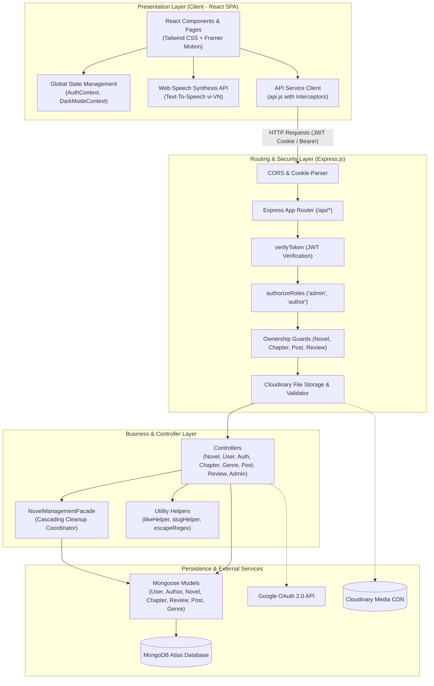
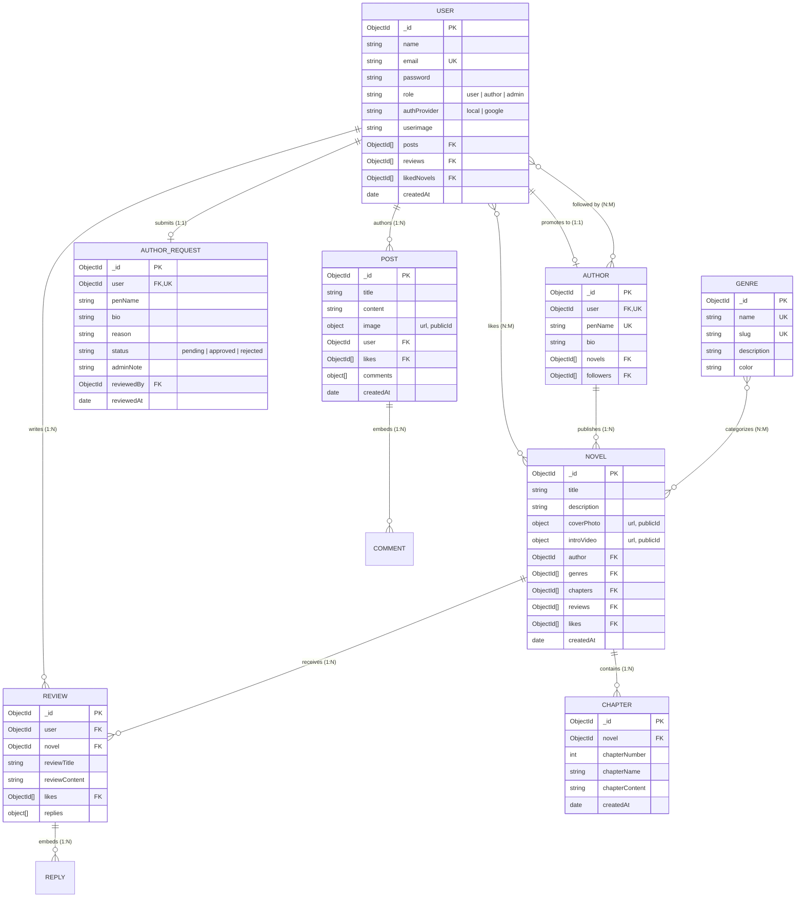
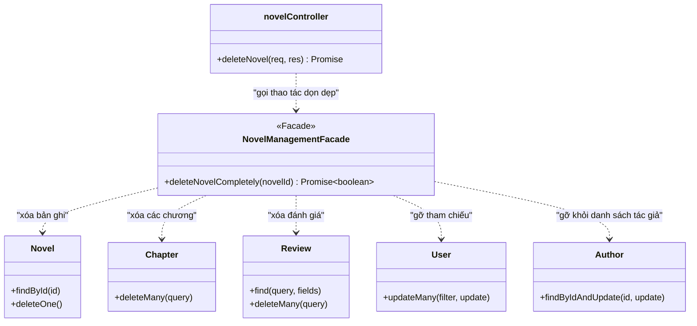
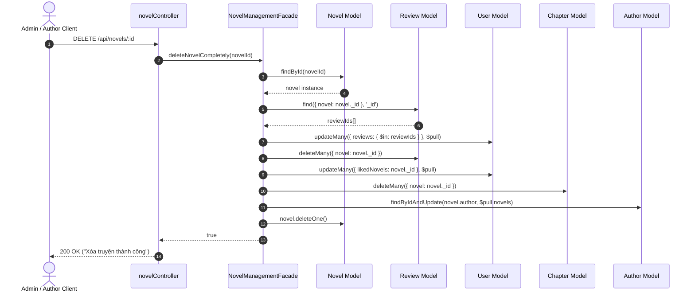
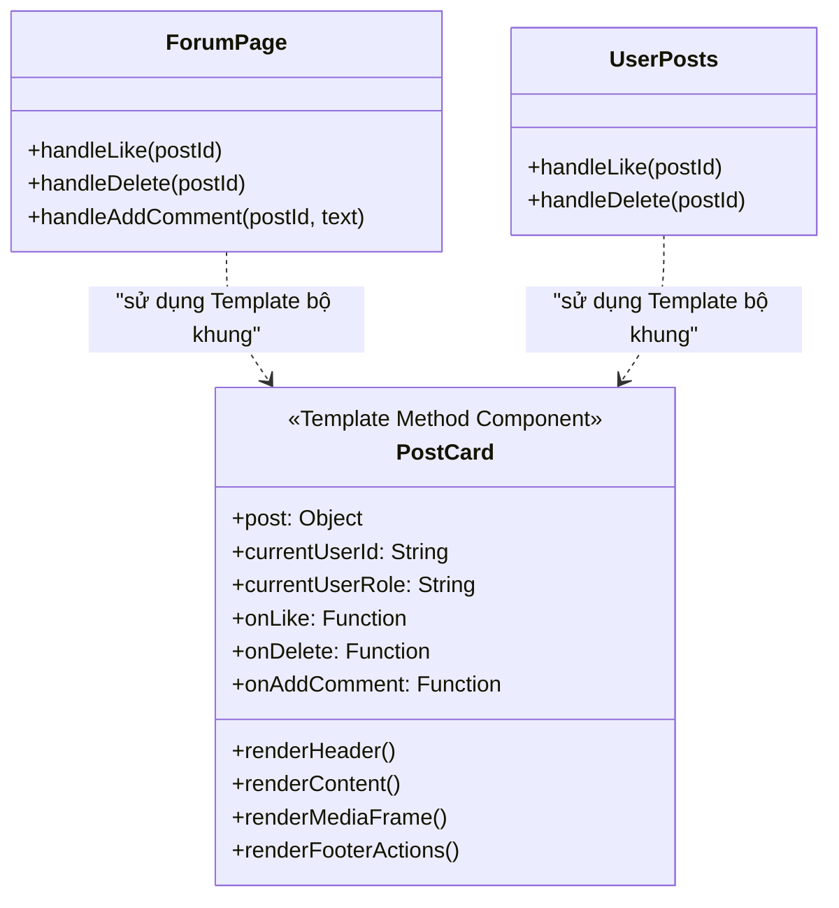
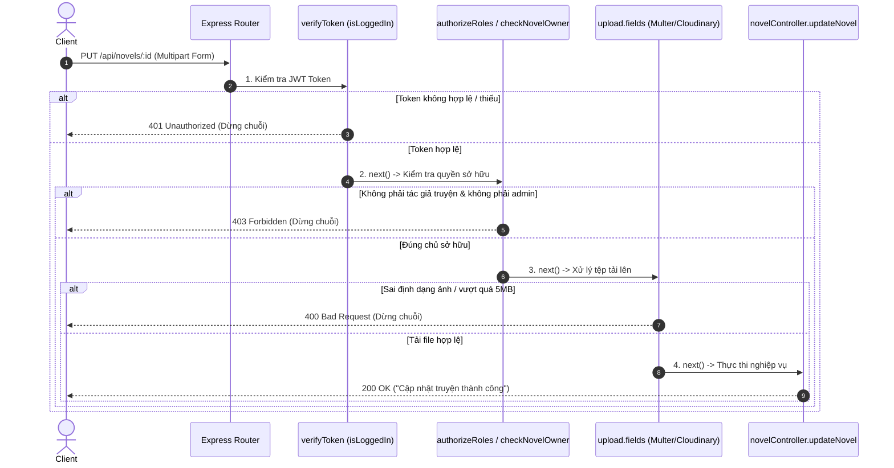
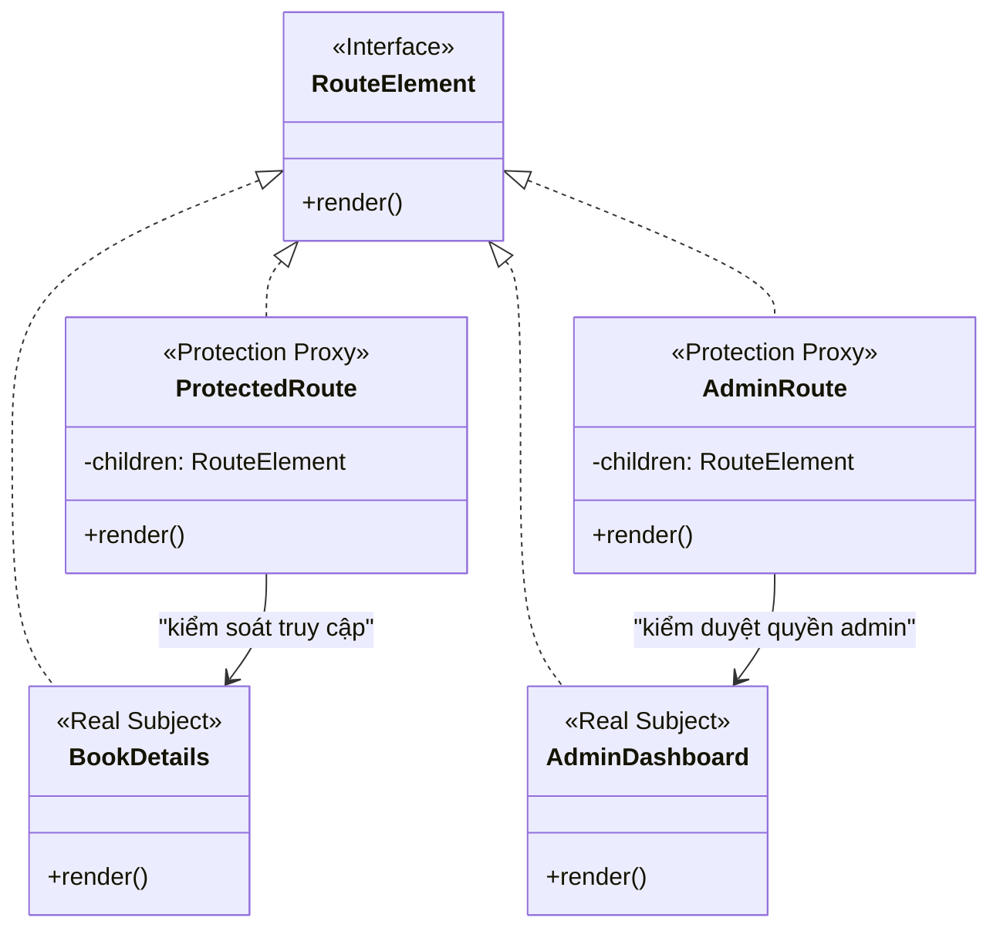
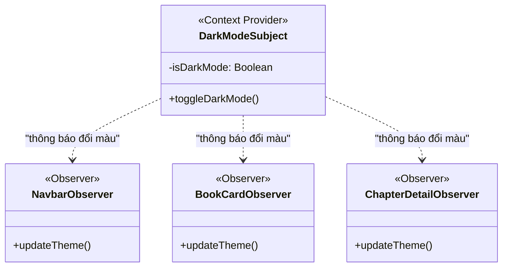
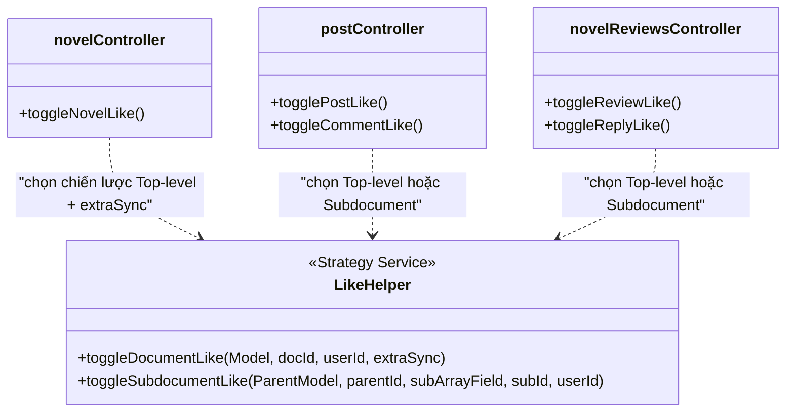
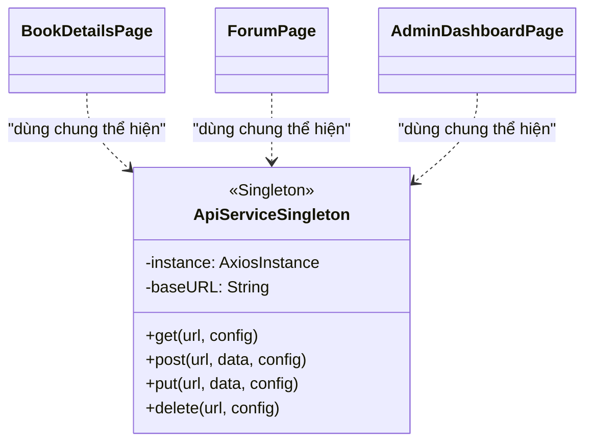

# Novel Nest - Nền Tảng Đọc Truyện & Sáng Tác Trực Tuyến

> **Báo cáo Kỹ thuật & Tài liệu Kiến trúc Hệ thống**  
> **Học phần:** Mẫu thiết kế (Design Patterns)  
> **Nhóm thực hiện:** Nhóm 19  
> **Mã nguồn dự án:** `TKW_Nhom19_NovelHub`  

---

## Mục lục (Table of Contents)
- [1. Giới thiệu dự án](#1-giới-thiệu-dự-án)
  - [1.1. Tên dự án & Bối cảnh](#11-tên-dự-án--bối-cảnh)
  - [1.2. Bài toán & Mục tiêu giải quyết](#12-bài-toán--mục-tiêu-giải-quyết)
  - [1.3. Đối tượng người dùng](#13-đối-tượng-người-dùng)
  - [1.4. Mục tiêu dự án](#14-mục-tiêu-dự-án)
  - [1.5. Thông tin nhóm thực hiện & Đồ án môn học](#15-thông-tin-nhóm-thực-hiện--đồ-án-môn-học)
- [2. Tính năng chính](#2-tính-năng-chính)
  - [2.1. Phân hệ Khách vãng lai & Độc giả (Reader)](#21-phân-hệ-khách-vãng-lai--độc-giả-reader)
  - [2.2. Phân hệ Tác giả (Author)](#22-phân-hệ-tác-giả-author)
  - [2.3. Phân hệ Quản trị viên (Admin)](#23-phân-hệ-quản-trị-viên-admin)
- [3. Công nghệ sử dụng](#3-công-nghệ-sử-dụng)
- [4. Kiến trúc tổng thể](#4-kiến-trúc-tổng-thể)
  - [4.1. Mô hình kiến trúc phần mềm](#41-mô-hình-kiến-trúc-phần-mềm)
  - [4.2. Sơ đồ kiến trúc tổng quan (System Architecture)](#42-sơ-đồ-kiến-trúc-tổng-quan-system-architecture)
  - [4.3. Cấu trúc thư mục dự án](#43-cấu-trúc-thư-mục-dự-án)
- [5. Thiết kế dữ liệu](#5-thiết-kế-dữ-liệu)
  - [5.1. Sơ đồ thực thể liên kết (ERD)](#51-sơ-đồ-thực-thể-liên-kết-erd)
  - [5.2. Chi tiết các Entity & Ràng buộc dữ liệu](#52-chi-tiết-các-entity--ràng-buộc-dữ-liệu)
- [6. Phân tích Design Patterns ⭐](#6-phân-tích-design-patterns-)
  - [6.1. Facade Pattern (Structural)](#61-facade-pattern-structural)
  - [6.2. Template Method Pattern (Behavioral)](#62-template-method-pattern-behavioral)
  - [6.3. Chain of Responsibility Pattern (Behavioral)](#63-chain-of-responsibility-pattern-behavioral)
  - [6.4. Proxy Pattern (Structural)](#64-proxy-pattern-structural)
  - [6.5. Observer Pattern (Behavioral)](#65-observer-pattern-behavioral)
  - [6.6. Strategy Pattern (Behavioral)](#66-strategy-pattern-behavioral)
  - [6.7. Singleton Pattern (Creational)](#67-singleton-pattern-creational)
  - [6.8. Bảng tổng hợp các Design Patterns](#68-bảng-tổng-hợp-các-design-patterns)
  - [6.9. Phân tích các nguyên lý SOLID qua Codebase](#69-phân-tích-các-nguyên-lý-solid-qua-codebase)
- [7. Đánh giá & Đề xuất cải tiến](#7-đánh-giá--đề-xuất-cải-tiến)
  - [7.1. Code Smells & Điểm hạn chế hiện tại](#71-code-smells--điểm-hạn-chế-hiện-tại)
  - [7.2. Các Design Pattern đề xuất áp dụng bổ sung](#72-các-design-pattern-đề-xuất-áp-dụng-bổ-sung)
- [8. Hướng dẫn cài đặt & Chạy ứng dụng](#8-hướng-dẫn-cài-đặt--chạy-ứng-dụng)
  - [8.1. Yêu cầu môi trường hệ thống](#81-yêu-cầu-môi-trường-hệ-thống)
  - [8.2. Cấu hình biến môi trường (.env)](#82-cấu-hình-biến-môi-trường-env)
  - [8.3. Khởi chạy dự án](#83-khởi-chạy-dự-án)
  - [8.4. Tài khoản Demo kiểm thử](#84-tài-khoản-demo-kiểm-thử)
- [9. Hướng dẫn sử dụng](#9-hướng-dẫn-sử-dụng)
- [10. Gợi ý cấu trúc báo cáo môn học](#10-gợi-ý-cấu-trúc-báo-cáo-môn-học)
- [11. Tài liệu tham khảo](#11-tài-liệu-tham-khảo)
- [Danh sách Placeholder cần bổ sung thông tin](#danh-sách-placeholder-cần-bổ-sung-thông-tin)

---

## 1. Giới thiệu dự án

### 1.1. Tên dự án & Bối cảnh
- **Tên dự án:** **Novel Nest** *(mã nguồn gốc lưu trữ dưới tên định danh module: `NovelHub`)*.
- **Bối cảnh:** Trong thời đại bùng nổ văn hóa đọc kỹ thuật số, nhu cầu tiếp cận các tác phẩm tiểu thuyết mạng (web novels) và tương tác trực tiếp giữa tác giả - độc giả ngày càng lớn. Novel Nest được xây dựng như một nền tảng đọc và sáng tác tiểu thuyết trực tuyến toàn diện, chú trọng trải nghiệm người dùng hiện đại kết hợp với kiến trúc phần mềm hướng đối tượng theo chuẩn công nghiệp.

### 1.2. Bài toán & Mục tiêu giải quyết
1. **Bài toán tương tác và trải nghiệm đọc:** Người đọc cần một môi trường đọc truyện tập trung, hỗ trợ chế độ giao diện Sáng/Tối (Dark/Light mode), chuyển chương mượt mà và khả năng **nghe truyện qua giọng đọc tự động (Text-To-Speech tiếng Việt)** khi không tiện nhìn màn hình.
2. **Bài toán kết nối cộng đồng:** Không chỉ dừng lại ở việc đọc, độc giả có thể đánh giá từng tác phẩm, bình luận thảo luận đa cấp, và tham gia Diễn đàn (Forum) cộng đồng để chia sẻ cảm nhận bằng văn bản và hình ảnh.
3. **Bài toán phân quyền xuất bản đa cấp:** Hỗ trợ quy trình phê duyệt nghiêm ngặt: từ Độc giả thông thường nộp đơn đăng ký kèm lý do và bút danh mong muốn, qua khâu thẩm định của Quản trị viên để trở thành Tác giả chính thức có quyền phát hành tiểu thuyết và quản lý chương.
4. **Bài toán tính toàn vẹn và giải phóng tài nguyên:** Xóa một tác phẩm không đơn thuần là xóa một dòng bản ghi, mà kéo theo dọn dẹp hàng loạt dữ liệu liên tầng (chương truyện, đánh giá, phản hồi, danh sách yêu thích của hàng ngàn người dùng, ảnh và video trên đám mây). Hệ thống giải quyết triệt để thông qua các mẫu thiết kế cấu trúc chuyên biệt.

### 1.3. Đối tượng người dùng
- **Khách vãng lai (Guest):** Xem danh mục truyện thịnh hành, bảng xếp hạng, đọc thử các chương, tìm kiếm theo thể loại hoặc từ khóa.
- **Độc giả (Reader - Role `user`):** Lưu truyện yêu thích, viết bài đánh giá (Review), bình luận, đăng bài thảo luận trên diễn đàn, nộp đơn xin cấp quyền Tác giả.
- **Tác giả (Author - Role `author`):** Đăng tải tác phẩm mới, tải lên ảnh bìa, video giới thiệu, tạo và cập nhật các chương truyện, theo dõi chỉ số tương tác (Novel Analytics).
- **Quản trị viên (Admin - Role `admin`):** Xét duyệt hoặc từ chối đơn xin làm tác giả, quản lý kho thể loại, giám sát bài viết diễn đàn, xóa tác phẩm vi phạm, phân quyền tài khoản trực tiếp.

### 1.4. Mục tiêu dự án
- **Mục tiêu chức năng:** Xây dựng một ứng dụng web Single Page Application (SPA) hoàn chỉnh với đầy đủ tính năng CRUD, phân quyền RBAC (Role-Based Access Control), xác thực kép (Local JWT & Google OAuth 2.0), lưu trữ đa phương tiện Cloudinary, tích hợp công cụ tổng hợp giọng nói Web Speech API.
- **Mục tiêu học thuật:** Ứng dụng thực tiễn các nguyên lý thiết kế hướng đối tượng **SOLID** và các **GoF Design Patterns** (Facade, Template Method, Chain of Responsibility, Proxy, Observer, Strategy, Singleton) vào hệ sinh thái JavaScript/Node.js hiện đại, làm rõ bằng chứng code và biểu đồ thiết kế UML.

### 1.5. Thông tin nhóm thực hiện & Đồ án môn học
- **Môn học:** Mẫu thiết kế (Design Patterns)
- **Mã lớp / Học kỳ:** `[Mã lớp - Học kỳ/Năm học]`
- **Giảng viên hướng dẫn:** `[Tên Giảng viên hướng dẫn]`
- **Nhóm thực hiện:** Nhóm 19
  - Thành viên 1: `[Tên thành viên 1 - MSSV]` (Trưởng nhóm)
  - Thành viên 2: `[Tên thành viên 2 - MSSV]`
  - Thành viên 3: `[Tên thành viên 3 - MSSV]` *(nếu có)*

---

## 2. Tính năng chính

### 2.1. Phân hệ Khách vãng lai & Độc giả (Reader)
- **Xác thực & Bảo mật:**
  - Đăng ký và Đăng nhập thông qua tài khoản cục bộ (mật khẩu băm an toàn bằng `bcryptjs`).
  - Đăng nhập một chạm bằng tài khoản Google (OAuth 2.0 tích hợp Google Identity Services).
  - Tự động duy trì phiên làm việc qua HTTP Cookie và tự động gia hạn/đăng xuất khi token hết hạn.
- **Khám phá tác phẩm:**
  - Danh mục truyện thịnh hành (Trending Novels) và bảng xếp hạng Top truyện theo lượt yêu thích (`/rankings`).
  - Lọc truyện theo thể loại động (Genre filtering với mã màu và slug tối ưu SEO).
  - Tìm kiếm toàn văn (Full-text search) theo tiêu đề truyện và tên tác giả.
- **Trải nghiệm đọc truyện (Reader Experience):**
  - Đọc danh sách chương tuần tự, chuyển chương trước/sau bằng phím tắt hoặc thanh điều hướng.
  - Tích hợp công cụ **Text-To-Speech (TTS)**: tự động băm nhỏ văn bản tiếng Việt thành các phân đoạn chuẩn (chunks), tự động nhận diện giọng đọc `vi-VN` của trình duyệt để đọc to nội dung chương.
- **Tương tác xã hội & Đánh giá:**
  - Thả tim / Bỏ thả tim truyện (đồng bộ danh sách truyện đã thích vào trang cá nhân).
  - Viết đánh giá truyện (Review) và tham gia thảo luận phân cấp (Replies).
  - Thả tim đánh giá và từng câu trả lời.
- **Diễn đàn cộng đồng (Forum):**
  - Đăng bài viết kèm hình ảnh minh họa (tải trực tiếp lên Cloudinary).
  - Bình luận bài viết, thả tim bài viết và bình luận.
  - Xem ảnh phóng to dạng Lightbox responsive.
- **Quản lý tài khoản cá nhân:**
  - Cập nhật ảnh đại diện (hỗ trợ cắt ảnh hình vuông bằng `ImageCropModal`), đổi mật khẩu.
  - Nộp đơn đăng ký trở thành Tác giả (`AuthorRequest`) kèm bút danh và lý do xét duyệt.

### 2.2. Phân hệ Tác giả (Author)
- **Đăng ký tác quyền:** Hệ thống bảo đảm tính duy nhất của bút danh (`penName`).
- **Quản lý tác phẩm (Novel Studio):**
  - Đăng tải truyện mới: nhập tiêu đề, mô tả, chọn nhiều thể loại, tải ảnh bìa và video giới thiệu (hỗ trợ tải file video hoặc liên kết YouTube).
  - Chỉnh sửa thông tin tác phẩm, cập nhật ảnh bìa mới.
  - Xóa truyện cá nhân (được bảo vệ quyền sở hữu qua middleware `checkNovelOwner`).
- **Quản lý chương (Chapter Management):**
  - Thêm chương mới cho tác phẩm (hệ thống tự động đánh số thứ tự chương tăng dần, cơ chế chống xung đột khóa duy nhất `novel + chapterNumber`).
  - Chỉnh sửa tên chương và nội dung chương.
- **Thống kê tác phẩm (Novel Analytics):**
  - Trang theo dõi chuyên biệt (`/novel-analytics/:novelId`) cung cấp tổng quan số chương, tổng lượt thích, danh sách phản hồi của độc giả.

### 2.3. Phân hệ Quản trị viên (Admin)
- **Bảng điều khiển trung tâm (Admin Dashboard - `/admin`):**
  - Thống kê thời gian thực: Tổng số người dùng, số tác giả, số tác phẩm, số bài viết, số thể loại và số đơn chờ duyệt.
- **Xét duyệt Tác giả (Author Request Workflow):**
  - Xem danh sách đơn đăng ký, lọc theo trạng thái: Chờ duyệt (`pending`), Đã duyệt (`approved`), Đã từ chối (`rejected`).
  - Duyệt đơn (hệ thống tự động nâng vai trò của user thành `author` và khởi tạo bản ghi trong collection `Author`).
  - Từ chối đơn kèm ghi chú lý do (`adminNote`).
- **Quản lý thể loại (Genre Management):**
  - Thêm mới thể loại kèm slug tự động hóa từ tiếng Việt có dấu, chọn bảng màu nhận diện (`COLOR_PRESETS`), sửa tên/mô tả/màu sắc, xóa thể loại.
- **Kiểm duyệt nội dung & Phân quyền:**
  - Kiểm duyệt danh sách tác phẩm: xóa truyện vi phạm bằng `NovelManagementFacade`.
  - Kiểm duyệt diễn đàn: xóa bài viết vi phạm.
  - Quản lý danh sách người dùng và chuyển đổi vai trò trực tiếp (`user` <-> `author` <-> `admin`).

---

## 3. Công nghệ sử dụng

| Công nghệ / Thư viện | Phiên bản | Vai trò trong hệ thống Novel Nest |
| :--- | :--- | :--- |
| **Node.js** | `>= 18` (Chuẩn `.nvmrc`: `22.19.0`) | Môi trường thực thi JavaScript phía máy chủ (Runtime Environment) |
| **Express.js** | `^4.19.2` | Web Framework phía backend, xây dựng RESTful API và Middleware Pipeline |
| **MongoDB & Mongoose** | `^8.8.3` | Hệ quản trị CSDL NoSQL hướng tài liệu & Thư viện ODM quản lý Schema, Data Modeling |
| **React** | `^18.3.1` | Thư viện xây dựng giao diện người dùng Single Page Application (SPA) hướng component |
| **Vite** | `^5.4.1` | Build tool và Development Server tốc độ cao cho Frontend |
| **React Router DOM** | `^6.26.1` | Bộ định tuyến phía máy khách (Client-side routing) với cơ chế bảo vệ Route Guards |
| **Tailwind CSS** | `^3.4.10` | Utility-first CSS Framework xây dựng giao diện tùy biến, hỗ trợ Dark Mode đa lớp |
| **Framer Motion** | `^11.13.1` | Thư viện xử lý hiệu ứng chuyển động (animations) và chuyển trang mượt mà |
| **JSON Web Token (jsonwebtoken)** | `^9.0.2` | Sinh và xác thực token JWT phục vụ cơ chế Stateless Authentication |
| **Bcrypt.js** | `^2.4.3` | Thuật toán băm một chiều an toàn (salt hashing) để mã hóa mật khẩu người dùng |
| **Multer & Multer-Storage-Cloudinary** | `^1.4.5` / `^4.0.0` | Middleware xử lý dữ liệu multipart/form-data và streaming media lên đám mây |
| **Cloudinary SDK** | `^1.41.3` | Dịch vụ đám mây lưu trữ, tối ưu hóa và chuyển đổi định dạng ảnh bìa, avatar, video |
| **Axios** | `^1.7.7` | HTTP Client phía client và server, cấu hình Interceptors tự động đính kèm token |
| **Google Auth Library & @react-oauth/google** | `^9.14.1` / `^0.12.1` | Tích hợp giao thức đăng nhập bảo mật OAuth 2.0 của Google |
| **Web Speech API** | *Native Browser API* | API tổng hợp giọng nói trình duyệt hỗ trợ tính năng Text-To-Speech tiếng Việt |

---

## 4. Kiến trúc tổng thể

### 4.1. Mô hình kiến trúc phần mềm
Novel Nest áp dụng **Kiến trúc Phân tầng (Layered Architecture)** kết hợp với mô hình **MVC (Model-View-Controller)** trên nền tảng **Client-Server RESTful**:
1. **Presentation Layer (Frontend - React Single Page Application):**
   - Đảm nhận hiển thị giao diện, điều hướng trang qua `React Router DOM`.
   - Quản lý trạng thái chia sẻ bằng **React Context API** (`AuthContext`, `DarkModeContext`).
   - Giao tiếp với máy chủ thông qua tầng dịch vụ trừu tượng hóa `api.js` (Axios Interceptors).
2. **Routing & Middleware Layer (Backend - Express Pipeline):**
   - Tiếp nhận các yêu cầu HTTP/HTTPS, định tuyến qua các Router con chuyên biệt.
   - Áp dụng mẫu **Chain of Responsibility** để thực hiện kiểm tra xác thực (Authentication), phân quyền vai trò (RBAC), kiểm tra quyền sở hữu dữ liệu (Ownership Guard), và xử lý tải file (Multer Storage).
3. **Controller / Business Logic Layer (Backend Controllers & Facade):**
   - Tiếp nhận input từ Request, gọi các hàm nghiệp vụ, điều phối các thao tác dữ liệu phức tạp thông qua `NovelManagementFacade`.
4. **Data Access & Persistence Layer (Mongoose ODM & MongoDB Atlas):**
   - Định nghĩa cấu trúc Schema, áp dụng Mongoose Lifecycle Hooks (`pre('save')`), tạo chỉ mục (Text Indexes) phục vụ tìm kiếm toàn văn.

---

### 4.2. Sơ đồ kiến trúc tổng quan (System Architecture)



---

### 4.3. Cấu trúc thư mục dự án

```text
TKW_Nhom19_NovelHub/
├── assets/                          # Tài nguyên đồ họa dự án (ảnh minh họa trang chủ)
│   └── home.png
├── backend/                         # Máy chủ Backend (Node.js / Express.js)
│   ├── authentication/
│   │   └── authentication.js        # Middleware xác thực JWT token (verifyToken)
│   ├── controllers/                 # Tầng điều khiển nghiệp vụ (Business Controllers)
│   │   ├── adminController.js       # Quản trị thống kê, duyệt tác giả, kiểm duyệt
│   │   ├── authController.js        # Đăng ký, đăng nhập cục bộ, đăng xuất
│   │   ├── authorController.js      # Nộp đơn làm tác giả, lấy thông tin tác giả
│   │   ├── chapterController.js     # Thêm, sửa, đọc chương tiểu thuyết
│   │   ├── genreController.js       # CRUD thể loại, lọc truyện theo slug
│   │   ├── novelController.js       # CRUD tiểu thuyết, tìm kiếm, thích truyện
│   │   ├── novelReviewsController.js# Quản lý đánh giá truyện và phản hồi
│   │   ├── postController.js        # Quản lý bài viết diễn đàn và bình luận
│   │   └── userController.js        # Cập nhật hồ sơ cá nhân, đổi mật khẩu, avatar
│   ├── middlewares/                 # Các middleware xử lý trung gian
│   │   ├── authorizeRoles.js        # Phân quyền vai trò RBAC
│   │   ├── cloudinaryStore.js       # Cấu hình lưu trữ và biến đổi file Cloudinary
│   │   ├── dbConnection.js          # Kết nối CSDL MongoDB (Singleton Pattern)
│   │   └── ownership.js             # Kiểm tra quyền sở hữu tài nguyên
│   ├── models/                      # Mô hình thực thể CSDL (Mongoose Schemas)
│   │   ├── Author.js                # Hồ sơ tác giả, bút danh, số người theo dõi
│   │   ├── AuthorRequest.js         # Đơn đăng ký quyền tác giả
│   │   ├── Chapter.js               # Nội dung chương và số thứ tự chương
│   │   ├── Genre.js                 # Danh mục thể loại, màu sắc, slug
│   │   ├── Novel.js                 # Tác phẩm tiểu thuyết, ảnh bìa, video, thể loại
│   │   ├── Post.js                  # Bài viết thảo luận diễn đàn, đính kèm ảnh
│   │   ├── Review.js                # Đánh giá truyện và các câu trả lời
│   │   └── User.js                  # Tài khoản người dùng, mật khẩu băm, vai trò
│   ├── oauth/
│   │   └── googleAuth.js            # Xử lý xác thực Google OAuth 2.0
│   ├── routes/                      # Định tuyến API Express
│   │   ├── adminRouter.js           # Tuyến đường /api/admin
│   │   ├── authorRouter.js          # Tuyến đường /api/authors
│   │   ├── authRouter.js            # Tuyến đường /api/auth
│   │   ├── chapterRouter.js         # Tuyến đường /api/chapters
│   │   ├── genreRouter.js           # Tuyến đường /api/genres
│   │   ├── googleAuthRouter.js      # Tuyến đường /api/oauth
│   │   ├── novelReviewsRouter.js    # Tuyến đường /api/novel-reviews
│   │   ├── novelRouter.js           # Tuyến đường /api/novels
│   │   ├── postRouter.js            # Tuyến đường /api/posts
│   │   └── userRouter.js            # Tuyến đường /api/users
│   ├── utils/                       # Các module tiện ích và mẫu thiết kế
│   │   ├── cloudinaryConfig.js      # Nạp cấu hình Cloudinary credentials
│   │   ├── escapeRegex.js           # Chuẩn hóa chuỗi RegExp tránh tấn công ReDoS
│   │   ├── likeHelper.js            # Helper xử lý thao tác thích đa hình (Strategy)
│   │   ├── NovelManagementFacade.js # Facade Pattern xử lý xóa truyện liên tầng
│   │   ├── seedAdmin.js             # Khởi tạo tài khoản Quản trị viên mặc định
│   │   ├── seedGenres.js            # Khởi tạo danh mục 8 thể loại gốc
│   │   └── slugHelper.js            # Tạo slug chuẩn từ tiếng Việt có dấu
│   ├── .env                         # Biến môi trường Backend
│   ├── .nvmrc                       # Phiên bản Node.js chỉ định (22.19.0)
│   ├── app.js                       # Điểm khởi động ứng dụng máy chủ (Server Entrypoint)
│   └── package.json                 # Khai báo gói thư viện Backend
├── frontend/                        # Ứng dụng máy khách (React SPA / Vite)
│   ├── public/                      # Tài nguyên tĩnh công khai (logo biểu tượng)
│   ├── src/
│   │   ├── assets/                  # Ảnh nền trang đăng nhập/đăng ký
│   │   ├── components/              # Các thành phần giao diện tái sử dụng
│   │   │   ├── AdminRoute.jsx       # Route Guard bảo vệ trang Admin (Proxy)
│   │   │   ├── ApplyAuthorship.jsx  # Form nộp đơn đăng ký tác giả
│   │   │   ├── AuthorSection.jsx    # Phân khu quản lý sáng tác của tác giả
│   │   │   ├── DisplayBooks.jsx     # Hiển thị lưới truyện responsive
│   │   │   ├── Forum.jsx            # Giao diện diễn đàn cộng đồng
│   │   │   ├── ImageCropModal.jsx   # Modal cắt cúp ảnh avatar tỉ lệ 1:1
│   │   │   ├── Interests.jsx        # Lựa chọn sở thích đọc truyện
│   │   │   ├── LikedNovels.jsx      # Danh sách truyện người dùng đã thích
│   │   │   ├── Navbar.jsx           # Thanh điều hướng chính (Search, Genre dropdown, Theme)
│   │   │   ├── NovelCover.jsx       # Khung hiển thị bìa truyện, video, thông tin tác giả
│   │   │   ├── NovelReviews.jsx     # Danh sách đánh giá truyện và phản hồi
│   │   │   ├── PostCard.jsx         # Card bài viết diễn đàn (Template Method)
│   │   │   ├── PostUpload.jsx       # Modal đăng bài viết mới kèm ảnh
│   │   │   ├── ProtectedRoute.jsx   # Route Guard bảo vệ trang yêu cầu đăng nhập (Proxy)
│   │   │   ├── UploadNovel.jsx      # Modal đăng tải tác phẩm mới
│   │   │   ├── UserPosts.jsx        # Danh sách bài viết do người dùng đăng
│   │   │   ├── WeeklyBest.jsx       # Truyện nổi bật trong tuần
│   │   │   └── WriteReview.jsx      # Form viết đánh giá tác phẩm
│   │   ├── context/                 # Quản lý trạng thái Observer (Context API)
│   │   │   ├── AuthContext.jsx      # Context quản lý phiên đăng nhập
│   │   │   ├── AuthState.jsx        # Provider cung cấp trạng thái xác thực và user
│   │   │   └── DarkModeContext.jsx  # Provider điều khiển chế độ Sáng / Tối
│   │   ├── pages/                   # Các màn hình chính của ứng dụng
│   │   │   ├── 404Page.jsx          # Trang thông báo không tìm thấy đường dẫn
│   │   │   ├── AdminDashboard.jsx   # Trang quản trị hệ thống đa tab
│   │   │   ├── BookDetails.jsx      # Trang chi tiết tiểu thuyết
│   │   │   ├── ChapterDetail.jsx    # Trình đọc chương truyện tích hợp Text-To-Speech
│   │   │   ├── Chapters.jsx         # Mục lục danh sách toàn bộ chương truyện
│   │   │   ├── Dashboard.jsx        # Trang quản lý hồ sơ cá nhân và tác giả
│   │   │   ├── ForumPage.jsx        # Trang diễn đàn cộng đồng
│   │   │   ├── HomePage.jsx         # Trang chủ hiển thị truyện thịnh hành
│   │   │   ├── LoginPage.jsx        # Trang đăng nhập
│   │   │   ├── NovelAnalytics.jsx   # Bảng điều khiển phân tích số liệu truyện
│   │   │   ├── Rankings.jsx         # Bảng xếp hạng tác phẩm được yêu thích nhất
│   │   │   ├── ReviewDetails.jsx    # Chi tiết bài đánh giá và thảo luận phản hồi
│   │   │   ├── SearchResults.jsx    # Trang kết quả tìm kiếm truyện theo từ khóa/thể loại
│   │   │   └── SignUpPage.jsx       # Trang đăng ký tài khoản mới
│   │   ├── services/
│   │   │   └── api.js               # Cấu hình Singleton Axios Client và Interceptors
│   │   ├── utils/                   # Giao diện phụ trợ (Footer, Book item, Google button)
│   │   ├── App.jsx                  # Thiết lập bộ định tuyến (Router) và bọc Route Guards
│   │   └── main.jsx                 # Điểm gắn kết DOM gốc (Root Render)
│   ├── .env                         # Biến môi trường Frontend
│   ├── package.json                 # Khai báo gói thư viện Frontend
│   ├── tailwind.config.js           # Cấu hình giao diện Tailwind CSS
│   └── vite.config.js               # Cấu hình Vite bundler
├── .gitignore                       # Danh sách loại trừ kiểm soát phiên bản Git
├── .nvmrc                           # Khai báo phiên bản Node.js gốc
└── README.md                        # Tài liệu kỹ thuật toàn diện dự án Novel Nest
```

---

## 5. Thiết kế dữ liệu

### 5.1. Sơ đồ thực thể liên kết (ERD)



### 5.2. Chi tiết các Entity & Ràng buộc dữ liệu
1. **User (Người dùng):**
   - Đảm bảo tính duy nhất của email (`unique: true, lowercase: true`).
   - Phân cấp 3 vai trò qua `enum: ['user', 'author', 'admin']`.
   - Phân biệt phương thức xác thực qua `authProvider: ['local', 'google']`.
   - Mật khẩu được mã hóa tự động trước khi lưu bằng middleware `pre('save')` với độ phức tạp `salt = 10`.
2. **Author (Tác giả):**
   - Liên kết 1-1 với User (`user: { unique: true }`).
   - Bút danh là duy nhất trên toàn hệ thống (`penName: { unique: true }`).
   - Hỗ trợ đánh chỉ mục văn bản: `authorSchema.index({ penName: 'text', bio: 'text' })`.
3. **AuthorRequest (Đơn đăng ký tác giả):**
   - Ràng buộc mỗi User chỉ có tối đa 1 yêu cầu xử lý tại một thời điểm (`user: { unique: true }`).
   - Lưu trữ vết kiểm duyệt (`reviewedBy`, `reviewedAt`, `adminNote`).
4. **Novel (Tiểu thuyết):**
   - Bắt buộc liên kết với một Tác giả đại diện (`author: { required: true, ref: 'Author' }`).
   - Hỗ trợ lưu trữ tài nguyên đa phương tiện Cloudinary gồm cả `url` và `publicId` (cho phép giải phóng tài nguyên trên CDN khi xóa).
   - Thiết lập Text Index trên hai trường tiêu đề và mô tả: `novelSchema.index({ title: 'text', description: 'text' })` phục vụ tìm kiếm toàn văn tốc độ cao.
5. **Chapter (Chương truyện):**
   - Thiết lập chỉ mục kép duy nhất (Compound Unique Index): `chapterSchema.index({ novel: 1, chapterNumber: 1 }, { unique: true })`. Ràng buộc này ngăn chặn triệt để tình trạng trùng lặp số chương trong cùng một bộ truyện khi có nhiều yêu cầu gửi đồng thời.
6. **Genre (Thể loại):**
   - Lưu trữ `slug` thân thiện với đường dẫn URL, tự động chuẩn hóa chữ thường và đánh chỉ mục riêng.
7. **Review & Post (Đánh giá & Bài viết):**
   - Áp dụng mô hình nhúng (Embedded Subdocument) cho `replies` trong `Review` và `comments` trong `Post` nhằm tối ưu hóa hiệu năng đọc của MongoDB (giảm thiểu thao tác `$lookup` tốn kém).
   - Cung cấp danh sách tham chiếu `likes` chứa mảng các `UserId`.

---

## 6. Phân tích Design Patterns ⭐

Trong đồ án Novel Nest, các mẫu thiết kế hướng đối tượng theo chuẩn GoF (Gang of Four) và các mẫu kiến trúc kinh điển đã được khảo sát và chứng minh hiện diện rõ nét trong mã nguồn.

---

### 6.1. Facade Pattern (Structural)

#### a. Định nghĩa & Mục đích (GoF)
Facade Pattern cung cấp một giao diện thống nhất, đơn giản hóa cho một tập hợp các giao diện trong một hệ thống con (subsystem). Facade định nghĩa một giao diện cấp cao hơn giúp hệ thống con trở nên dễ sử dụng hơn, đồng thời giảm sự phụ thuộc trực tiếp (loose coupling) giữa client và các lớp nghiệp vụ phức tạp.

#### b. Vấn đề giải quyết trong Novel Nest
Thao tác xóa hoàn toàn một tác phẩm tiểu thuyết (`Novel`) là một quy trình nghiệp vụ phức tạp, liên tầng và tiềm ẩn nguy cơ để lại dữ liệu rác (orphan records):
- Cần tìm và xóa toàn bộ các đánh giá (`Review`) của bộ truyện.
- Phải cập nhật lại danh sách `reviews` của tất cả người dùng từng viết đánh giá cho bộ truyện đó.
- Phải duyệt qua toàn bộ người dùng để rút mã `novelId` ra khỏi danh sách yêu thích `likedNovels`.
- Phải xóa triệt để tất cả các chương (`Chapter`) thuộc về truyện.
- Phải cập nhật lại danh sách tác phẩm `novels` của Tác giả (`Author`).
- Cuối cùng mới xóa bản ghi `Novel`.

Nếu để `novelController.js` hoặc `adminController.js` tự thực hiện các bước này thì mã nguồn sẽ bị phình to (Fat Controller), vi phạm nguyên lý Single Responsibility. Lớp `NovelManagementFacade` ra đời nhằm đóng gói toàn bộ quy trình này vào một lời gọi hàm duy nhất.

#### c. Vị trí áp dụng
- **File triển khai:** [NovelManagementFacade.js](file:///d:/M%E1%BA%ABu%20thi%E1%BA%BFt%20k%E1%BA%BF/Nhom_19/TKW_Nhom19_NovelHub/backend/utils/NovelManagementFacade.js)
- **File sử dụng:** [novelController.js](file:///d:/M%E1%BA%ABu%20thi%E1%BA%BFt%20k%E1%BA%BF/Nhom_19/TKW_Nhom19_NovelHub/backend/controllers/novelController.js#L185-L201)

#### d. Bảng ánh xạ các thành phần tham gia

| Thành phần trong GoF | Lớp trong dự án Novel Nest | Vai trò cụ thể |
| :--- | :--- | :--- |
| **Facade** | `NovelManagementFacade` | Cung cấp phương thức static `deleteNovelCompletely(novelId)` để xóa sạch toàn diện |
| **Subsystem Class 1** | `Novel` (Mongoose Model) | Thực thể tiểu thuyết mục tiêu cần xóa |
| **Subsystem Class 2** | `Chapter` (Mongoose Model) | Tập hợp các chương cần dọn dẹp theo `novel._id` |
| **Subsystem Class 3** | `Review` (Mongoose Model) | Các đánh giá liên quan cần xóa |
| **Subsystem Class 4** | `User` (Mongoose Model) | Cập nhật mảng `reviews` và mảng `likedNovels` |
| **Subsystem Class 5** | `Author` (Mongoose Model) | Cập nhật mảng `novels` của tác giả sở hữu |
| **Client** | `novelController` (deleteNovel) | Gọi Facade mà không cần quan tâm đến logic dọn dẹp liên kết |

#### e. Sơ đồ lớp UML (Mermaid Class Diagram)



#### f. Sơ đồ tuần tự (Mermaid Sequence Diagram)



#### g. Code minh họa trích từ dự án

```javascript
// Trích: backend/utils/NovelManagementFacade.js (dòng 11-55)
class NovelManagementFacade {
    static async deleteNovelCompletely(novelId) {
        const novel = await Novel.findById(novelId);
        if (!novel) throw new Error('Không tìm thấy truyện cần xóa');

        // 1. Tìm các review của truyện và xóa tham chiếu trong User.reviews
        const reviewsToDelete = await Review.find({ novel: novel._id }, '_id');
        const reviewIds = reviewsToDelete.map(r => r._id);
        if (reviewIds.length > 0) {
            await User.updateMany({ reviews: { $in: reviewIds } }, { $pull: { reviews: { $in: reviewIds } } });
            await Review.deleteMany({ novel: novel._id });
        }
        // 2. Xóa novelId khỏi likedNovels của mọi người dùng
        await User.updateMany({ likedNovels: novel._id }, { $pull: { likedNovels: novel._id } });
        // 3. Xóa toàn bộ các chương (Chapter) thuộc truyện
        await Chapter.deleteMany({ novel: novel._id });
        // 4. Xóa novelId khỏi danh sách novels của tác giả
        if (novel.author) {
            await Author.findByIdAndUpdate(novel.author, { $pull: { novels: novel._id } });
        }
        // 5. Xóa truyện khỏi cơ sở dữ liệu
        await novel.deleteOne();
        return true;
    }
}
```

```javascript
// Trích: backend/controllers/novelController.js (dòng 186-191)
const deleteNovel = async (req, res) => {
    try {
        const novelId = req.params.id;
        await NovelManagementFacade.deleteNovelCompletely(novelId);
        return res.status(200).json({ msg: "Xóa truyện thành công" });
    } catch (error) { ... }
};
```

#### h. Ưu điểm & Nhược điểm
- **Ưu điểm:**
  - Tách rời hoàn toàn controller khỏi chi tiết cài đặt của các mô hình phụ trợ; đảm bảo tính toàn vẹn dữ liệu ở cấp độ ứng dụng.
  - Tái sử dụng dễ dàng trong cả nghiệp vụ của Tác giả (xóa truyện của mình) lẫn Quản trị viên (xóa truyện vi phạm từ Admin Dashboard).
- **Hạn chế:** Hiện các thao tác chạy tuần tự độc lập mà chưa được bọc trong một MongoDB Transaction (`session.startTransaction()`), do đó nếu server bị ngắt đột ngột giữa chừng vẫn có thể tồn tại rủi ro dữ liệu không trọn vẹn.

---

### 6.2. Template Method Pattern (Behavioral)

#### a. Định nghĩa & Mục đích (GoF)
Template Method Pattern định nghĩa bộ khung (skeleton) của một thuật toán trong một phương thức, chuyển giao việc thực hiện một số bước cụ thể cho các cấu trúc con hoặc component con mà không làm thay đổi cấu trúc tổng thể của thuật toán.

#### b. Vấn đề giải quyết trong Novel Nest
Trong ứng dụng, một bài viết (Post) được hiển thị ở nhiều ngữ cảnh khác nhau:
1. Trang **Diễn đàn chung (ForumPage)**: nơi hiển thị bài viết của mọi thành viên trong cộng đồng, hỗ trợ tương tác thảo luận.
2. Trang **Hồ sơ cá nhân (UserPosts)**: nơi chỉ hiển thị các bài viết thuộc về chính người dùng đang đăng nhập.

Cả hai nơi đều yêu cầu một cấu trúc hiển thị 4 bước cố định và nhất quán:
- **Bước 1 (Header):** Ảnh đại diện tác giả -> Tên tác giả + Ngày đăng -> Nút xóa bài viết (chỉ kích hoạt nếu là tác giả hoặc admin).
- **Bước 2 (Body):** Tiêu đề bài viết -> Đoạn văn bản nội dung.
- **Bước 3 (Media):** Khung ảnh đính kèm (auto-fit responsive frame, không vỡ layout, tích hợp mở Lightbox xem chi tiết).
- **Bước 4 (Footer & Actions):** Nút thả tim (kèm số lượng) -> Nút mở bình luận -> Danh sách bình luận dạng accordian -> Ô nhập bình luận mới.

Component `PostCard.jsx` đóng vai trò là Template Method, định nghĩa cấu trúc 4 bước bất biến, trong khi các hàm callback tương tác (`onLike`, `onDelete`, `onAddComment`, `showCommentsDefault`) được truyền linh hoạt từ trang cha.

#### c. Vị trí áp dụng
- **File triển khai:** [PostCard.jsx](file:///d:/M%E1%BA%ABu%20thi%E1%BA%BFt%20k%E1%BA%BF/Nhom_19/TKW_Nhom19_NovelHub/frontend/src/components/PostCard.jsx)
- **Nơi tái sử dụng:**
  - [ForumPage.jsx](file:///d:/M%E1%BA%ABu%20thi%E1%BA%BFt%20k%E1%BA%BF/Nhom_19/TKW_Nhom19_NovelHub/frontend/src/pages/ForumPage.jsx#L141-L151)
  - [UserPosts.jsx](file:///d:/M%E1%BA%ABu%20thi%E1%BA%BFt%20k%E1%BA%BF/Nhom_19/TKW_Nhom19_NovelHub/frontend/src/components/UserPosts.jsx#L42-L52)

#### d. Bảng ánh xạ các thành phần tham gia

| Thành phần Template Method | Thành phần trong Novel Nest | Vai trò cụ thể |
| :--- | :--- | :--- |
| **Abstract Template / Framework** | `PostCard` Component | Định hình thứ tự 4 bước dựng UI cố định |
| **Primitive Step 1 (Header)** | `renderHeader()` | Dựng Avatar, thông tin ngày tạo, nút kiểm tra quyền xóa |
| **Primitive Step 2 (Body)** | `renderContent()` | Dựng Title và Content text với kiểu dáng chuẩn hóa |
| **Primitive Step 3 (Media)** | `renderImageFrame()` | Dựng khung ảnh với cơ chế chống méo, nút zoom Lightbox |
| **Primitive Step 4 (Footer)** | `renderInteractionFooter()` | Dựng khối thả tim, nút đếm bình luận và form submit comment |
| **Concrete Context A** | `ForumPage` | Triển khai Template với hành vi cộng đồng (mặc định đóng comments) |
| **Concrete Context B** | `UserPosts` | Triển khai Template trong hồ sơ cá nhân |

#### e. Sơ đồ lớp UML (Mermaid Class Diagram)



#### f. Code minh họa trích từ dự án

```javascript
// Trích: frontend/src/components/PostCard.jsx (dòng 5-22, 60-120)
/**
 * PostCard Component (Template Method Pattern)
 * Định nghĩa bộ khung chuẩn hóa cho hiển thị bài viết trên cả Diễn đàn và Profile:
 * 1. Header: Avatar -> Tên + Ngày tháng -> Nút Xóa bài (nếu có quyền)
 * 2. Thân bài viết: Tiêu đề -> Nội dung văn bản
 * 3. Khung hình ảnh đính kèm: Auto-fit responsive frame (không vỡ, không cắt xén)
 * 4. Chân tương tác: Lượt thích, Bình luận & Khung thảo luận
 */
const PostCard = ({
  post,
  currentUserId,
  currentUserRole,
  isDarkMode,
  onLike,
  onDelete,
  onAddComment,
  showCommentsDefault = false,
}) => {
  // Skeleton implementation of the 4 standard steps in JSX:
  // Step 1: Header rendering with permission check
  // Step 2: Text Title & Body rendering
  // Step 3: Responsive Image container & Lightbox modal
  // Step 4: Likes button, comments toggle & comments list
```

#### g. Ưu điểm & Nhược điểm
- **Ưu điểm:** Loại bỏ triệt để việc trùng lặp mã HTML/CSS giữa các trang có hiển thị bài viết; khi cần đổi kiểu dáng (UI theme, đổi icon thả tim hay cấu trúc comment), lập trình viên chỉ cần sửa duy nhất tại `PostCard.jsx`.
- **Hạn chế:** Trong môi trường functional components của React, pattern này được thể hiện thông qua component composition và props hooks thay vì kế thừa lớp (`extends`) kinh điển của GoF.

---

### 6.3. Chain of Responsibility Pattern (Behavioral)

#### a. Định nghĩa & Mục đích (GoF)
Chain of Responsibility Pattern cho phép chuyển tiếp các yêu cầu (requests) dọc theo một chuỗi các đối tượng xử lý (handlers). Khi nhận được yêu cầu, mỗi handler quyết định tự xử lý hoặc chuyển giao yêu cầu cho handler tiếp theo trong chuỗi.

#### b. Vấn đề giải quyết trong Novel Nest
Các yêu cầu gửi lên hệ thống backend đòi hỏi nhiều bước thẩm định tuần tự, phụ thuộc lẫn nhau:
1. **Bước 1 (Xác thực):** Kiểm tra xem client có gửi token JWT hợp lệ hay không?
2. **Bước 2 (Kiểm tra vai trò):** Tài khoản có đủ quyền hạn trong danh sách cho phép (ví dụ `admin`) hay không?
3. **Bước 3 (Kiểm tra quyền sở hữu):** Nếu là tác giả, họ có phải là người tạo ra tác phẩm hoặc chương truyện này hay không?
4. **Bước 4 (Xử lý tập tin):** Tệp tin tải lên có đúng định dạng ảnh/video cho phép và kích thước không vượt quá giới hạn hay không?
5. **Bước 5 (Nghiệp vụ):** Thực thi lưu trữ cơ sở dữ liệu.

Nếu đưa tất cả các bước này vào bên trong Controller, mã nguồn sẽ trở nên cực kỳ rối rắm và khó kiểm thử. Bằng cách áp dụng Chain of Responsibility thông qua Express Middleware Pipeline, mỗi middleware là một mắt xích độc lập.

#### c. Vị trí áp dụng
- **Handler 1 (Authentication):** [authentication.js](file:///d:/M%E1%BA%ABu%20thi%E1%BA%BFt%20k%E1%BA%BF/Nhom_19/TKW_Nhom19_NovelHub/backend/authentication/authentication.js) (`verifyToken`)
- **Handler 2 (RBAC Authorization):** [authorizeRoles.js](file:///d:/M%E1%BA%ABu%20thi%E1%BA%BFt%20k%E1%BA%BF/Nhom_19/TKW_Nhom19_NovelHub/backend/middlewares/authorizeRoles.js) (`authorizeRoles`)
- **Handler 3 (Resource Ownership):** [ownership.js](file:///d:/M%E1%BA%ABu%20thi%E1%BA%BFt%20k%E1%BA%BF/Nhom_19/TKW_Nhom19_NovelHub/backend/middlewares/ownership.js) (`checkNovelOwner`, `checkChapterUploadPermission`, `checkChapterEditPermission`, `checkReviewOwner`, `checkPostOwner`)
- **Handler 4 (File Filter & Upload):** [cloudinaryStore.js](file:///d:/M%E1%BA%ABu%20thi%E1%BA%BFt%20k%E1%BA%BF/Nhom_19/TKW_Nhom19_NovelHub/backend/middlewares/cloudinaryStore.js) (`upload.fields`, `upload.single`)
- **Chuỗi liên kết tại Routes:**
  - [novelRouter.js](file:///d:/M%E1%BA%ABu%20thi%E1%BA%BFt%20k%E1%BA%BF/Nhom_19/TKW_Nhom19_NovelHub/backend/routes/novelRouter.js#L19-L22)
  - [chapterRouter.js](file:///d:/M%E1%BA%ABu%20thi%E1%BA%BFt%20k%E1%BA%BF/Nhom_19/TKW_Nhom19_NovelHub/backend/routes/chapterRouter.js#L10-L13)
  - [adminRouter.js](file:///d:/M%E1%BA%ABu%20thi%E1%BA%BFt%20k%E1%BA%BF/Nhom_19/TKW_Nhom19_NovelHub/backend/routes/adminRouter.js#L8)

#### d. Bảng ánh xạ các thành phần tham gia

| Vai trò Chain of Responsibility | Middleware trong Novel Nest | Trách nhiệm cụ thể |
| :--- | :--- | :--- |
| **Handler Interface** | Express Middleware Signature | Chuẩn `(req, res, next) => void` |
| **Concrete Handler 1** | `verifyToken` (`isLoggedIn`) | Kiểm tra JWT token từ cookie/header. Hợp lệ thì gán `req.user` và gọi `next()`, ngược lại trả về `401 Unauthorized` |
| **Concrete Handler 2** | `authorizeRoles(...roles)` | Kiểm tra quyền của người dùng. Đúng vai trò thì gọi `next()`, ngược lại trả về `403 Forbidden` |
| **Concrete Handler 3** | `checkNovelOwner` / `checkPostOwner` | Kiểm tra tài khoản có phải tác giả của bản ghi hoặc là admin. Nếu đúng gọi `next()`, ngược lại ngắt chuỗi với `403` |
| **Concrete Handler 4** | `upload.fields(...)` (Multer) | Phân loại mime-type, validate kích thước, đẩy dữ liệu lên Cloudinary rồi gọi `next()` |
| **End of Chain (Target)** | Controller Handler | Thực hiện nghiệp vụ chính sau khi vượt qua tất cả các chốt chặn |

#### e. Sơ đồ chuỗi xử lý (Mermaid Sequence Diagram)



#### f. Code minh họa trích từ dự án

```javascript
// Trích: backend/routes/novelRouter.js (dòng 19-24)
// Thiết lập chuỗi Chain of Responsibility bảo vệ endpoint cập nhật tiểu thuyết:
novelRouter.put(
    '/:id', 
    isLoggedIn,           // Mắt xích 1: Xác thực danh tính
    checkNovelOwner,      // Mắt xích 2: Xác minh quyền tác giả sở hữu
    upload.fields([       // Mắt xích 3: Kiểm tra và tải ảnh bìa/video
        { name: 'coverPhoto', maxCount: 1 },
        { name: 'introVideo', maxCount: 1 }
    ]), 
    novelController.updateNovel // Đích đến: Cập nhật CSDL
);
```

```javascript
// Trích: backend/middlewares/authorizeRoles.js (dòng 7-27)
const authorizeRoles = (...allowedRoles) => {
    return async (req, res, next) => {
        try {
            const userId = req.user?.userId;
            if (!userId) return res.status(401).json({ msg: "Truy cập bị từ chối. Vui lòng đăng nhập." });
            const user = await User.findById(userId);
            if (!user) return res.status(401).json({ msg: "Không tìm thấy người dùng." });
            if (!allowedRoles.includes(user.role)) {
                return res.status(403).json({ 
                    msg: `Từ chối truy cập. Yêu cầu quyền: [${allowedRoles.join(', ')}]. Quyền hiện tại của bạn: [${user.role}].` 
                });
            }
            req.userDoc = user;
            next(); // Chuyển giao sang mắt xích kế tiếp
        } catch (error) { ... }
    };
};
```

#### g. Ưu điểm & Nhược điểm
- **Ưu điểm:** Khả năng tái sử dụng và ghép nối cực kỳ linh hoạt (nguyên lý Open/Closed Principle); dễ dàng bổ sung các mắt xích mới như Rate Limiting, Request Logging, Data Sanitization mà không cần chạm vào code của controller.
- **Hạn chế:** Nếu một mắt xích quên gọi `next()` hoặc quên gửi phản hồi lỗi, request sẽ bị treo (hang) vô thời hạn.

---

### 6.4. Proxy Pattern (Structural)

#### a. Định nghĩa & Mục đích (GoF)
Proxy Pattern cung cấp một đối tượng đại diện (surrogate hoặc placeholder) để kiểm soát quyền truy cập tới một đối tượng khác. Các loại proxy phổ biến gồm: Protection Proxy (kiểm soát quyền truy cập), Remote Proxy (đại diện cho đối tượng từ xa), và Interceptor Proxy (chặn và bổ sung hành vi).

#### b. Vấn đề giải quyết trong Novel Nest
Trong ứng dụng Novel Nest, Proxy Pattern xuất hiện ở hai vị trí trọng yếu:
1. **Protection Proxy phía Client (`ProtectedRoute`, `AdminRoute`):**
   - Độc giả không được phép truy cập vào các trang cá nhân, viết đánh giá hoặc diễn đàn nếu chưa đăng nhập.
   - Người dùng thông thường không được phép truy cập vào bảng điều khiển quản trị `/admin`.
   - `ProtectedRoute` và `AdminRoute` đóng vai trò là Protection Proxy bọc quanh các component trang thực tế, kiểm tra điều kiện bảo mật trước khi cho phép component đích được render.
2. **Interceptor Proxy phía HTTP Client (`api.js`):**
   - Mọi request HTTP gửi đi đều cần tự động đính kèm `Authorization: Bearer <token>` từ cookie.
   - Mọi response nhận về nếu gặp mã lỗi `401 Unauthorized` cần tự động xóa cookie phiên và điều hướng về trang đăng nhập.
   - `axios.interceptors` đóng vai trò như một Proxy can thiệp vào dòng dữ liệu vào/ra của HTTP client.

#### c. Vị trí áp dụng
- **Protection Proxy:**
  - [ProtectedRoute.jsx](file:///d:/M%E1%BA%ABu%20thi%E1%BA%BFt%20k%E1%BA%BF/Nhom_19/TKW_Nhom19_NovelHub/frontend/src/components/ProtectedRoute.jsx)
  - [AdminRoute.jsx](file:///d:/M%E1%BA%ABu%20thi%E1%BA%BFt%20k%E1%BA%BF/Nhom_19/TKW_Nhom19_NovelHub/frontend/src/components/AdminRoute.jsx)
  - [App.jsx](file:///d:/M%E1%BA%ABu%20thi%E1%BA%BFt%20k%E1%BA%BF/Nhom_19/TKW_Nhom19_NovelHub/frontend/src/App.jsx#L32-L41)
- **Interceptor Proxy:**
  - [api.js](file:///d:/M%E1%BA%ABu%20thi%E1%BA%BFt%20k%E1%BA%BF/Nhom_19/TKW_Nhom19_NovelHub/frontend/src/services/api.js)

#### d. Bảng ánh xạ các thành phần tham gia

| Vai trò trong GoF | Lớp trong Novel Nest | Chức năng cụ thể |
| :--- | :--- | :--- |
| **Subject Interface** | React Route Element / Axios Request | Giao diện chuẩn cho component hiển thị hoặc HTTP Call |
| **Real Subject 1** | `BookDetails`, `ForumPage`, `Dashboard` | Các trang chức năng thực tế của hệ thống |
| **Real Subject 2** | `AdminDashboard` | Trang quản trị hệ thống cấp cao |
| **Protection Proxy 1** | `ProtectedRoute` | Kiểm tra token hợp lệ thông qua `AuthContext.isAuthenticated()` trước khi render |
| **Protection Proxy 2** | `AdminRoute` | Kiểm tra vai trò `loggedUser.role === 'admin'` trước khi cho phép truy cập |
| **Interceptor Proxy** | `api.interceptors` | Can thiệp thêm header Authorization và xử lý ngoại lệ 401 tập trung |

#### e. Sơ đồ lớp UML (Mermaid Class Diagram)



#### f. Code minh họa trích từ dự án

```javascript
// Trích: frontend/src/components/ProtectedRoute.jsx (dòng 5-13)
const ProtectedRoute = ({ children }) => {
  const { isAuthenticated } = useContext(AuthContext);

  if (!isAuthenticated()) {
    return <Navigate to="/login" replace />;
  }

  return children;
};
```

```javascript
// Trích: frontend/src/components/AdminRoute.jsx (dòng 5-18)
const AdminRoute = ({ children }) => {
  const { isAuthenticated, loggedUser } = useContext(AuthContext);

  if (!isAuthenticated()) {
    return <Navigate to="/login" replace />;
  }

  // Chặn nếu vai trò không phải admin
  if (loggedUser && Object.keys(loggedUser).length > 0 && loggedUser.role !== "admin") {
    return <Navigate to="/home" replace />;
  }

  return children;
};
```

```javascript
// Trích: frontend/src/services/api.js (dòng 8-37)
// Bộ chặn request: tự động đính kèm tiêu đề Authorization nếu token tồn tại
api.interceptors.request.use((config) => {
  const token = Cookies.get("token");
  if (token) config.headers.Authorization = `Bearer ${token}`;
  return config;
});

// Bộ chặn response: khi nhận lỗi 401, xóa cookie và chuyển hướng về /login
api.interceptors.response.use(
  (response) => response,
  (error) => {
    if (error.response && error.response.status === 401) {
      Cookies.remove("token");
      Cookies.remove("userId");
      if (typeof window !== "undefined" && !window.location.pathname.includes("/login")) {
        window.location.href = "/login";
      }
    }
    return Promise.reject(error);
  }
);
```

#### g. Ưu điểm & Nhược điểm
- **Ưu điểm:** Bảo vệ an toàn ứng dụng từ tầng giao diện; ngăn chặn hiện tượng rò rỉ giao diện (UI flickering) trước khi dữ liệu được load; tập trung hóa mã xác thực HTTP giúp các component không phải xử lý thủ công việc gán token.
- **Hạn chế:** Bảo vệ phía client chỉ mang tính nâng cao trải nghiệm người dùng (UX); việc bảo mật thực sự vẫn phải luôn được kiểm chứng song song ở backend bằng middleware.

---

### 6.5. Observer Pattern (Behavioral)

#### a. Định nghĩa & Mục đích (GoF)
Observer Pattern định nghĩa mối phụ thuộc một-nhiều (one-to-many) giữa các đối tượng. Khi một đối tượng (Subject/Observable) thay đổi trạng thái, tất cả các đối tượng phụ thuộc vào nó (Observers) sẽ được thông báo tự động và cập nhật tương ứng.

#### b. Vấn đề giải quyết trong Novel Nest
1. **Quản lý trạng thái giao diện toàn cục (Dark Mode & Authentication):**
   - Trạng thái giao diện Sáng/Tối (`isDarkMode`) cần được đồng bộ tức thì trên toàn bộ các component: `Navbar`, `BookCard`, `ChapterDetail`, `AdminDashboard`, `Footer`.
   - Trạng thái đăng nhập (`loggedUser`, `isAuthenticated`) cần được thông báo tới thanh điều hướng `Navbar` (hiển thị Avatar thay vì nút Đăng nhập) và các Route Guards.
   - React Context API hoạt động chính xác theo cơ chế Publish-Subscribe của Observer Pattern: `Provider` là Subject, các component gọi `useContext(...)` là các Observers.
2. **Mongoose Document Lifecycle Hooks:**
   - Trong `User.js`, sự kiện lưu tài liệu (`save`) là một Subject. Hàm middleware `pre('save')` là một Observer đăng ký lắng nghe để tự động băm mật khẩu trước khi dữ liệu chạm vào ổ đĩa.
3. **Mongoose Connection Event Emitter:**
   - Trong `dbConnection.js`, kết nối MongoDB là Subject phát ra các sự kiện mạng (`error`, `disconnected`, `reconnected`), các callback đăng ký qua `.on(...)` là các Observers phản ứng lại sự cố mất kết nối.

#### c. Vị trí áp dụng
- **Context API (Frontend):**
  - [DarkModeContext.jsx](file:///d:/M%E1%BA%ABu%20thi%E1%BA%BFt%20k%E1%BA%BF/Nhom_19/TKW_Nhom19_NovelHub/frontend/src/context/DarkModeContext.jsx)
  - [AuthState.jsx](file:///d:/M%E1%BA%ABu%20thi%E1%BA%BFt%20k%E1%BA%BF/Nhom_19/TKW_Nhom19_NovelHub/frontend/src/context/AuthState.jsx)
- **Mongoose Lifecycle Hook & Event Emitter (Backend):**
  - [User.js](file:///d:/M%E1%BA%ABu%20thi%E1%BA%BFt%20k%E1%BA%BF/Nhom_19/TKW_Nhom19_NovelHub/backend/models/User.js#L54-L65) (`pre('save')`)
  - [dbConnection.js](file:///d:/M%E1%BA%ABu%20thi%E1%BA%BFt%20k%E1%BA%BF/Nhom_19/TKW_Nhom19_NovelHub/backend/middlewares/dbConnection.js#L9-L19) (`mongoose.connection.on(...)`)

#### d. Bảng ánh xạ các thành phần tham gia

| Vai trò trong GoF | Lớp / Module trong Novel Nest | Trách nhiệm |
| :--- | :--- | :--- |
| **Subject (Observable)** | `DarkModeContext.Provider` | Nắm giữ trạng thái `isDarkMode`, phát thông báo khi giá trị đảo ngược |
| **Subject (Observable)** | `AuthState (AuthContext.Provider)` | Nắm giữ `loggedUser`, định kỳ quét thời hạn token (30s) và phát tín hiệu đăng xuất |
| **Subject (Observable)** | `UserSchema` (Mongoose) | Phát sự kiện vòng đời `'save'` |
| **Concrete Observer** | `Navbar`, `Book`, `ChapterDetail`... | Lắng nghe qua `useContext()`, tự động render lại giao diện khi Subject đổi màu |
| **Concrete Observer** | `pre('save') hook` | Lắng nghe sự kiện lưu User, thực hiện băm mật khẩu bằng `bcryptjs` |

#### e. Sơ đồ lớp UML (Mermaid Class Diagram)



#### f. Code minh họa trích từ dự án

```javascript
// Trích: frontend/src/context/DarkModeContext.jsx (dòng 6-29)
export const DarkModeProvider = ({ children }) => {
  const [isDarkMode, setIsDarkMode] = useState(() => {
    const savedMode = Cookies.get('darkMode');
    return savedMode ? JSON.parse(savedMode) : true;
  });

  useEffect(() => {
    Cookies.set('darkMode', JSON.stringify(isDarkMode), { expires: 365 });
    if (isDarkMode) {
      document.documentElement.classList.add('dark');
    } else {
      document.documentElement.classList.remove('dark');
    }
  }, [isDarkMode]);

  const toggleDarkMode = () => setIsDarkMode(prev => !prev);

  return (
    <DarkModeContext.Provider value={{ isDarkMode, toggleDarkMode }}>
      {children}
    </DarkModeContext.Provider>
  );
};
```

```javascript
// Trích: backend/models/User.js (dòng 54-65) - Mongoose Lifecycle Hook Observer
userSchema.pre('save', async function(next) {
  if (!this.isModified('password')) return next();
  try {
    const salt = await bcryptjs.genSalt(10);
    this.password = await bcryptjs.hash(this.password, salt);
    next();
  } catch (error) {
    next(error);
  }
});
```

#### g. Ưu điểm & Nhược điểm
- **Ưu điểm:** Khớp nối lỏng giữa nơi phát sinh trạng thái và nơi tiêu thụ giao diện; tự động hóa hoàn toàn việc cập nhật cây DOM mà không cần gọi hàm cập nhật thủ công (imperative DOM manipulation).
- **Hạn chế:** Nếu đặt quá nhiều state trong một Context duy nhất, mọi sự thay đổi nhỏ đều có thể khiến toàn bộ các component con bị re-render không cần thiết, làm giảm hiệu năng ứng dụng.

---

### 6.6. Strategy Pattern (Behavioral)

#### a. Định nghĩa & Mục đích (GoF)
Strategy Pattern định nghĩa một họ các thuật toán, đóng gói từng thuật toán lại và làm cho chúng có thể hoán đổi cho nhau. Strategy cho phép thuật toán biến đổi độc lập với các client sử dụng nó.

#### b. Vấn đề giải quyết trong Novel Nest
1. **Chiến lược Thích / Bỏ thích (Like/Unlike Strategy):**
   - Hệ thống có nhiều thực thể khác nhau hỗ trợ tính năng thả tim: Tác phẩm (`Novel`), Bài viết diễn đàn (`Post`), Đánh giá truyện (`Review`), Bình luận bài viết (`Post.comments`), Câu trả lời đánh giá (`Review.replies`).
   - Cấu trúc dữ liệu của các thực thể cấp cao (Top-level Document) khác với cấu trúc mảng lồng nhau (Subdocument Array). Ngoài ra, khi thích một cuốn tiểu thuyết, hệ thống cần thêm một chiến lược đồng bộ phụ: ghi nhận vào danh sách `likedNovels` của người dùng.
   - Module [likeHelper.js](file:///d:/M%E1%BA%ABu%20thi%E1%BA%BFt%20k%E1%BA%BF/Nhom_19/TKW_Nhom19_NovelHub/backend/utils/likeHelper.js) đóng gói hai chiến lược thuật toán riêng biệt:
     - `toggleDocumentLike`: Chiến lược áp dụng cho các Top-level Documents với tùy chọn đồng bộ bảng User.
     - `toggleSubdocumentLike`: Chiến lược áp dụng cho các mảng con lồng nhau sử dụng toán tử định vị vị trí của MongoDB (`$`).
2. **Chiến lược Tải và Lưu trữ tệp tin (Cloudinary Upload Strategy):**
   - Trong [cloudinaryStore.js](file:///d:/M%E1%BA%ABu%20thi%E1%BA%BFt%20k%E1%BA%BF/Nhom_19/TKW_Nhom19_NovelHub/backend/middlewares/cloudinaryStore.js), tùy thuộc vào loại trường (`coverPhoto`, `introVideo`, `avatar`, `image`), thuật toán tự động chọn thư mục đích trên Cloudinary và áp dụng các thông số biến đổi (Transformation parameters) khác nhau (cắt ảnh khuôn mặt cho avatar, tỉ lệ bìa 600x400 cho cover, giới hạn kích thước 2048px cho bài viết).

#### c. Vị trí áp dụng
- **Like Strategy:** [likeHelper.js](file:///d:/M%E1%BA%ABu%20thi%E1%BA%BFt%20k%E1%BA%BF/Nhom_19/TKW_Nhom19_NovelHub/backend/utils/likeHelper.js)
  - Được sử dụng bởi: `novelController.js`, `postController.js`, `novelReviewsController.js`.
- **Upload Strategy:** [cloudinaryStore.js](file:///d:/M%E1%BA%ABu%20thi%E1%BA%BFt%20k%E1%BA%BF/Nhom_19/TKW_Nhom19_NovelHub/backend/middlewares/cloudinaryStore.js)

#### d. Bảng ánh xạ các thành phần tham gia

| Thành phần Strategy | Thành phần trong Novel Nest | Vai trò |
| :--- | :--- | :--- |
| **Strategy Context** | Controller Endpoints (`toggleNovelLike`, `togglePostLike`, `toggleCommentLike`...) | Tiếp nhận yêu cầu HTTP và ủy thác việc thực hiện cho Strategy phù hợp |
| **Concrete Strategy 1** | `toggleDocumentLike(Model, docId, userId, extraSync)` | Thuật toán toggle like cho tài liệu độc lập và đồng bộ trường quan hệ |
| **Concrete Strategy 2** | `toggleSubdocumentLike(ParentModel, parentId, subField, subId, userId)` | Thuật toán toggle like trên mảng con sử dụng toán tử mảng MongoDB |

#### e. Sơ đồ lớp UML (Mermaid Class Diagram)



#### f. Code minh họa trích từ dự án

```javascript
// Trích: backend/utils/likeHelper.js (dòng 10-34)
async function toggleDocumentLike(Model, docId, userId, extraSync = null) {
    const user = await User.findById(userId);
    if (!user) return { status: 404, msg: 'User not found' };

    const doc = await Model.findById(docId);
    if (!doc) return { status: 404, msg: `${Model.modelName || 'Document'} not found` };

    const isLiked = doc.likes.some(id => id.toString() === userId.toString());
    const update = isLiked ? { $pull: { likes: userId } } : { $addToSet: { likes: userId } };
    const updatedDoc = await Model.findByIdAndUpdate(docId, update, { new: true });

    if (extraSync && extraSync.field) {
        const userUpdate = isLiked 
            ? { $pull: { [extraSync.field]: docId } } 
            : { $addToSet: { [extraSync.field]: docId } };
        await User.findByIdAndUpdate(userId, userUpdate);
    }

    return { status: 200, data: updatedDoc };
}
```

#### g. Ưu điểm & Nhược điểm
- **Ưu điểm:** Tránh lặp lại mã nguồn thao tác MongoDB `$pull` / `$addToSet` tại hàng chục controller khác nhau; tuân thủ triệt để nguyên lý DRY (Don't Repeat Yourself).
- **Hạn chế:** Tham số truyền vào hàm linh hoạt theo kiểu dynamic của JavaScript; nếu thiếu TypeScript kiểm tra kiểu dữ liệu tĩnh thì có thể xảy ra lỗi lúc chạy nếu truyền sai tên trường `subArrayField`.

---

### 6.7. Singleton Pattern (Creational)

#### a. Định nghĩa & Mục đích (GoF)
Singleton Pattern đảm bảo rằng một lớp chỉ có duy nhất một thể hiện (instance) trong suốt vòng đời của ứng dụng và cung cấp một điểm truy cập toàn cầu tới thể hiện đó.

#### b. Vấn đề giải quyết trong Novel Nest
1. **Kết nối Cơ sở dữ liệu (Database Connection Pool):**
   - Việc mở kết nối mới tới cơ sở dữ liệu MongoDB Atlas mỗi khi có một request HTTP là cực kỳ tốn kém về mặt tài nguyên CPU, mạng và thời gian bắt tay (handshake).
   - Trong [dbConnection.js](file:///d:/M%E1%BA%ABu%20thi%E1%BA%BFt%20k%E1%BA%BF/Nhom_19/TKW_Nhom19_NovelHub/backend/middlewares/dbConnection.js), ứng dụng sử dụng `mongoose.connect()`. Mongoose quản lý một Connection Pool nội tại dưới dạng Singleton. Bất kể có bao nhiêu file model gọi `mongoose.model()`, tất cả đều chia sẻ chung một phiên kết nối CSDL duy nhất.
2. **Đối tượng HTTP Client trung tâm (`api.js`):**
   - Phía frontend, cần một đối tượng Axios duy nhất được thiết lập sẵn `baseURL`, cấu hình thời gian chờ và đăng ký sẵn các `interceptors`.
   - File [api.js](file:///d:/M%E1%BA%ABu%20thi%E1%BA%BFt%20k%E1%BA%BF/Nhom_19/TKW_Nhom19_NovelHub/frontend/src/services/api.js) khởi tạo thể hiện `api = axios.create(...)` và xuất ra ngoài (export default). Bất kỳ trang nào `import api from "../services/api"` đều trỏ tới cùng một thể hiện Singleton này.

#### c. Vị trí áp dụng
- **Backend Database Singleton:** [dbConnection.js](file:///d:/M%E1%BA%ABu%20thi%E1%BA%BFt%20k%E1%BA%BF/Nhom_19/TKW_Nhom19_NovelHub/backend/middlewares/dbConnection.js) & [app.js](file:///d:/M%E1%BA%ABu%20thi%E1%BA%BFt%20k%E1%BA%BF/Nhom_19/TKW_Nhom19_NovelHub/backend/app.js#L22-L25)
- **Frontend HTTP Client Singleton:** [api.js](file:///d:/M%E1%BA%ABu%20thi%E1%BA%BFt%20k%E1%BA%BF/Nhom_19/TKW_Nhom19_NovelHub/frontend/src/services/api.js)

#### d. Bảng ánh xạ các thành phần tham gia

| Vai trò Singleton | Thành phần trong Novel Nest | Cơ chế hiện thực |
| :--- | :--- | :--- |
| **Singleton Instance 1** | `mongoose.connection` | Node.js Module Caching đảm bảo module `mongoose` chỉ khởi tạo 1 lần |
| **Singleton Instance 2** | `api` (Axios Client) | Module caching của ES6 Modules đảm bảo chỉ tồn tại duy nhất một đối tượng `api` |

#### e. Sơ đồ cấu trúc Singleton (Mermaid Class Diagram)



#### f. Code minh họa trích từ dự án

```javascript
// Trích: frontend/src/services/api.js (dòng 1-6, 39)
import axios from "axios";
import Cookies from "js-cookie";

// Khởi tạo một thể hiện Singleton duy nhất cho toàn bộ ứng dụng Frontend
const api = axios.create({
  baseURL: import.meta.env.VITE_API_URL,
});

export default api;
```

#### g. Ưu điểm & Nhược điểm
- **Ưu điểm:** Tiết kiệm tài nguyên bộ nhớ tối đa, ngăn ngừa rò rỉ kết nối mạng (connection leak), kiểm soát tập trung cấu hình của các dịch vụ cốt lõi.
- **Hạn chế:** Khó viết Unit Test độc lập nếu không áp dụng kỹ thuật Dependency Injection để thay thế thể hiện Singleton bằng mock object.

---

### 6.8. Bảng tổng hợp các Design Patterns

| STT | Tên Pattern | Nhóm GoF | Module / Chức năng áp dụng | File chính chứa bằng chứng code |
| :---: | :--- | :--- | :--- | :--- |
| **1** | **Facade Pattern** | Structural | Dọn dẹp dữ liệu xóa truyện đa tầng | `backend/utils/NovelManagementFacade.js` |
| **2** | **Template Method** | Behavioral | Bộ khung hiển thị bài viết diễn đàn / profile | `frontend/src/components/PostCard.jsx` |
| **3** | **Chain of Responsibility** | Behavioral | Chuỗi Middleware xác thực, phân quyền, upload | `backend/routes/novelRouter.js`, `backend/middlewares/*.js` |
| **4** | **Proxy Pattern** | Structural | Route Guards bảo vệ trang & Interceptor HTTP | `frontend/src/components/ProtectedRoute.jsx`, `api.js` |
| **5** | **Observer Pattern** | Behavioral | Quản lý trạng thái giao diện & Lifecycle Hooks | `frontend/src/context/DarkModeContext.jsx`, `User.js` |
| **6** | **Strategy Pattern** | Behavioral | Thuật toán Like đa hình & Upload Cloudinary | `backend/utils/likeHelper.js`, `cloudinaryStore.js` |
| **7** | **Singleton Pattern** | Creational | Quản lý kết nối CSDL MongoDB & Axios API Client | `backend/middlewares/dbConnection.js`, `frontend/src/services/api.js` |

---

### 6.9. Phân tích các nguyên lý SOLID qua Codebase

Dự án Novel Nest phản ánh sinh động 5 nguyên lý thiết kế hướng đối tượng SOLID:

#### 1. S - Single Responsibility Principle (Nguyên lý đơn trách nhiệm)
- Mỗi module chỉ đảm nhận một lý do duy nhất để thay đổi.
- **Minh chứng code:**
  - [NovelManagementFacade.js](file:///d:/M%E1%BA%ABu%20thi%E1%BA%BFt%20k%E1%BA%BF/Nhom_19/TKW_Nhom19_NovelHub/backend/utils/NovelManagementFacade.js): Chỉ chịu trách nhiệm điều phối việc dọn dẹp các thực thể liên quan khi xóa một cuốn tiểu thuyết. Nó không tham gia vào việc validate dữ liệu HTTP hay sinh mã trả về cho client.
  - [slugHelper.js](file:///d:/M%E1%BA%ABu%20thi%E1%BA%BFt%20k%E1%BA%BF/Nhom_19/TKW_Nhom19_NovelHub/backend/utils/slugHelper.js): Chỉ chịu trách nhiệm loại bỏ dấu tiếng Việt và tạo slug URL chuẩn.
  - [escapeRegex.js](file:///d:/M%E1%BA%ABu%20thi%E1%BA%BFt%20k%E1%BA%BF/Nhom_19/TKW_Nhom19_NovelHub/backend/utils/escapeRegex.js): Chỉ chịu trách nhiệm vô hiệu hóa các ký tự đặc biệt trong biểu thức chính quy.

#### 2. O - Open/Closed Principle (Nguyên lý Đóng/Mở)
- Hệ thống mở rộng được tính năng mới mà không phải sửa đổi mã nguồn đã chạy ổn định.
- **Minh chứng code:**
  - Middleware [authorizeRoles.js](file:///d:/M%E1%BA%ABu%20thi%E1%BA%BFt%20k%E1%BA%BF/Nhom_19/TKW_Nhom19_NovelHub/backend/middlewares/authorizeRoles.js): Hàm được thiết kế với cú pháp rest parameter `(...allowedRoles)`. Khi hệ thống cần bổ sung vai trò mới như `'moderator'` hay `'editor'`, lập trình viên chỉ cần truyền thêm tham số vào route `authorizeRoles('admin', 'moderator')` mà không cần viết lại hay chỉnh sửa logic bên trong middleware.

#### 3. L - Liskov Substitution Principle (Nguyên lý thay thế Liskov)
- Các đối tượng con hoặc đối tượng cùng kiểu có thể thay thế lẫn nhau mà không làm phá vỡ tính đúng đắn của chương trình.
- **Minh chứng code:**
  - Trong [likeHelper.js](file:///d:/M%E1%BA%ABu%20thi%E1%BA%BFt%20k%E1%BA%BF/Nhom_19/TKW_Nhom19_NovelHub/backend/utils/likeHelper.js), hàm `toggleDocumentLike(Model, docId, userId)` nhận tham số `Model` đại diện cho một Mongoose Model tổng quát. Vì các Model `Novel`, `Post`, `Review` đều tuân theo cùng một hợp đồng (đều có các phương thức `findById`, `findByIdAndUpdate` và trường `likes`), nên chúng có thể thay thế cho nhau một cách hoàn hảo mà không làm phát sinh lỗi.

#### 4. I - Interface Segregation Principle (Nguyên lý phân tách giao diện)
- Thay vì một giao diện khổng lồ chứa mọi thứ, chia nhỏ thành các giao diện chuyên biệt để client chỉ cần phụ thuộc vào những gì họ thực sự sử dụng.
- **Minh chứng code:**
  - File [ownership.js](file:///d:/M%E1%BA%ABu%20thi%E1%BA%BFt%20k%E1%BA%BF/Nhom_19/TKW_Nhom19_NovelHub/backend/middlewares/ownership.js) không gộp chung một hàm kiểm tra sở hữu đa năng mà phân tách rạch ròi thành các hàm riêng biệt: `checkNovelOwner`, `checkChapterUploadPermission`, `checkChapterEditPermission`, `checkReviewOwner`, `checkPostOwner`. Route nào cần quyền nào thì chỉ import đúng middleware đó.

#### 5. D - Dependency Inversion Principle (Nguyên lý đảo ngược phụ thuộc)
- Các module cấp cao không nên phụ thuộc trực tiếp vào các module cấp thấp; cả hai nên phụ thuộc vào các trừu tượng (Abstractions).
- **Minh chứng code:**
  - Toàn bộ các component giao diện người dùng phía React (`BookDetails.jsx`, `Rankings.jsx`, `Dashboard.jsx`) không gọi trực tiếp API trình duyệt thô (`fetch`) hay cấu hình thủ công các headers mạng, mà đều phụ thuộc vào tầng dịch vụ trừu tượng hóa là thể hiện `api` trong `api.js`. Nếu sau này ứng dụng chuyển đổi thư viện mạng từ Axios sang TanStack Query hay GraphQL Client, các component giao diện hoàn toàn không bị ảnh hưởng.

---

## 7. Đánh giá & Đề xuất cải tiến

### 7.1. Code Smells & Điểm hạn chế hiện tại
1. **God Component tại trang Quản trị:**
   - File [AdminDashboard.jsx](file:///d:/M%E1%BA%ABu%20thi%E1%BA%BFt%20k%E1%BA%BF/Nhom_19/TKW_Nhom19_NovelHub/frontend/src/pages/AdminDashboard.jsx) có độ dài hơn 1800 dòng lệnh, ôm đồm quá nhiều trách nhiệm: quản lý thống kê, xử lý danh sách đơn duyệt tác giả, kiểm duyệt truyện, quản lý diễn đàn, đổi vai trò người dùng và CRUD thể loại. Điều này vi phạm nguyên lý Single Responsibility.
2. **Thiếu vắng Tầng Dịch vụ (Service Layer) / Repository Pattern ở Backend:**
   - Các controller hiện tại (`novelController.js`, `chapterController.js`) vừa trực tiếp phân tích HTTP Request, vừa gọi thẳng Mongoose Model queries (`Novel.find()`, `Chapter.save()`), vừa định dạng dữ liệu trả về. Việc kết hợp chặt chẽ này gây khó khăn cho việc viết Unit Test cho logic nghiệp vụ độc lập với cơ sở dữ liệu.
3. **Tính toán Bảng xếp hạng ở bộ nhớ ứng dụng (In-Memory Sorting):**
   - Trong [Rankings.jsx](file:///d:/M%E1%BA%ABu%20thi%E1%BA%BFt%20k%E1%BA%BF/Nhom_19/TKW_Nhom19_NovelHub/frontend/src/pages/Rankings.jsx#L35-L39), ứng dụng lấy toàn bộ danh sách truyện về phía client rồi mới dùng hàm `.sort()` của JavaScript để tìm Top 10. Khi số lượng tiểu thuyết tăng lên hàng chục ngàn bộ, thao tác này sẽ gây nghẽn băng thông và sụp đổ hiệu năng trình duyệt.
4. **Thiếu cơ chế Database Transaction:**
   - Các thao tác xóa dọn dẹp liên kết trong `NovelManagementFacade.js` chưa sử dụng MongoDB Multi-document ACID Transactions, tiềm ẩn rủi ro nếu có lỗi phát sinh giữa các bước xóa.

---

### 7.2. Các Design Pattern đề xuất áp dụng bổ sung

#### 1. Repository Pattern (Kiến trúc dữ liệu)
- **Mục đích:** Tách rời hoàn toàn tầng truy cập dữ liệu (Data Access Layer) khỏi tầng điều khiển nghiệp vụ (Controller).
- **Hướng triển khai:**
  - Tạo các lớp `NovelRepository`, `UserRepository`, `ChapterRepository` đóng gói các truy vấn Mongoose.
  - Controller sẽ chỉ gọi các phương thức như `novelRepo.findPopular()`, `novelRepo.deleteWithCascade(id)`. Điều này cho phép dễ dàng mock dữ liệu khi viết Unit Test mà không cần kết nối tới MongoDB thật.

#### 2. Factory Method Pattern (Creational)
- **Mục đích:** Đóng gói quá trình khởi tạo các loại nội dung đa dạng trong hệ thống.
- **Hướng triển khai:**
  - Xây dựng `ContentFactory` với phương thức `createContent(type, data)`. Khi người dùng tạo một bài viết (`Post`), một đánh giá (`Review`) hay một chương truyện (`Chapter`), Factory sẽ chịu trách nhiệm tiền xử lý, kiểm tra định dạng media tương ứng và sinh ra đối tượng chuẩn.

#### 3. Command Pattern (Behavioral)
- **Mục đích:** Đóng gói các yêu cầu thao tác của người dùng thành các đối tượng độc lập, cho phép xếp hàng thực thi (queueing) hoặc hoàn tác (Undo/Redo).
- **Hướng triển khai:**
  - Áp dụng cho các thao tác sáng tác của tác giả: tự động lưu bản nháp chương truyện (Draft autosave), hoàn tác các chỉnh sửa nội dung văn bản trong trình soạn thảo.

---

## 8. Hướng dẫn cài đặt & Chạy ứng dụng

### 8.1. Yêu cầu môi trường hệ thống
- **Hệ điều hành:** Windows 10/11, macOS hoặc Linux.
- **Node.js:** Phiên bản `>= 18.0.0` (Khuyến nghị sử dụng chuẩn `v22.19.0` theo khai báo `.nvmrc`).
- **Trình quản lý gói:** `npm` (đi kèm Node.js) hoặc `yarn`.
- **Cơ sở dữ liệu:** Cụm MongoDB Atlas trực tuyến hoặc máy chủ MongoDB Community cài đặt cục bộ trên máy.
- **Tài khoản Cloudinary:** Để lấy thông tin API Keys phục vụ lưu trữ ảnh và video.
- **Google Cloud Console:** Client ID để kích hoạt tính năng đăng nhập Google OAuth.

---

### 8.2. Cấu hình biến môi trường (.env)

#### a. Cấu hình phía Backend
Tạo tệp `backend/.env` với các tham số mẫu:
```env
# Cổng lắng nghe của máy chủ Express
PORT=3002

# Chuỗi kết nối MongoDB Atlas (Thay thế bằng URI của bạn)
MONGO_URI=mongodb+srv://<username>:<password>@<cluster>.mongodb.net/<database_name>?retryWrites=true&w=majority

# Chuỗi bí mật ký mã hóa JSON Web Token (JWT)
jwt_secret=your_super_secret_jwt_key_here

# Cấu hình Google OAuth 2.0 (Lấy từ Google Cloud Console)
GOOGLE_CLIENT_ID=your_google_client_id.apps.googleusercontent.com
GOOGLE_CLIENT_SECRET=your_google_client_secret

# Cấu hình Cloudinary (Lấy từ Cloudinary Dashboard)
CLOUDINARY_CLOUD_NAME=your_cloudinary_cloud_name
CLOUDINARY_API_KEY=your_cloudinary_api_key
CLOUDINARY_API_SECRET=your_cloudinary_api_secret
```

#### b. Cấu hình phía Frontend
Tạo tệp `frontend/.env` với các tham số mẫu:
```env
# Địa chỉ API của máy chủ Backend
VITE_API_URL=http://localhost:3002/api

# Khóa Client ID cho Google OAuth đăng nhập phía Client
VITE_API_GOOGLE_CLIENT_ID=your_google_client_id.apps.googleusercontent.com
```

---

### 8.3. Khởi chạy dự án

#### Bước 1: Khởi động máy chủ Backend
Mở một cửa sổ dòng lệnh (Terminal / PowerShell):
```bash
# 1. Di chuyển vào thư mục backend
cd backend

# 2. Cài đặt các gói thư viện phụ thuộc
npm install

# 3. Khởi chạy máy chủ ở chế độ phát triển (sử dụng nodemon tự động reload)
npm start
```
> Khi khởi động thành công, màn hình console sẽ hiển thị:
> ```text
> Server đang chạy tại http://localhost:3002
> MongoDB Connected: [tên máy chủ MongoDB]
> ✅ Khởi tạo tài khoản Admin mặc định thành công: Admin123 / Admin123
> ✅ Khởi tạo thể loại mặc định thành công
> ```

#### Bước 2: Khởi động ứng dụng Frontend
Mở một cửa sổ dòng lệnh thứ hai:
```bash
# 1. Di chuyển vào thư mục frontend
cd frontend

# 2. Cài đặt các gói thư viện phụ thuộc
npm install

# 3. Khởi chạy máy chủ phát triển Vite
npm run dev
```
> Trình duyệt sẽ mở ứng dụng tại địa chỉ: `http://localhost:5173`.

#### Bước 3: Kiểm thử tự động (Testing)
- `⚠️ Chưa xác định được bộ kiểm thử tự động từ source code`: Trong file `backend/package.json`, kịch bản `"test"` hiện được định nghĩa mặc định là `"echo \"Error: no test specified\" && exit 1"`. Nhóm đang kiểm thử thủ công (Manual Testing) và đề xuất bổ sung bộ kiểm thử Jest/Supertest trong kế hoạch phát triển tương lai.

---

### 8.4. Tài khoản Demo kiểm thử

Hệ thống được lập trình sẵn cơ chế tự động nạp dữ liệu khởi tạo (Auto-seeding) mỗi khi khởi động server:

| Vai trò | Tên đăng nhập / Email | Mật khẩu mặc định | Quyền hạn trong hệ thống |
| :--- | :--- | :--- | :--- |
| **Quản trị viên (Admin)** | `Admin123@novelhub.com` *(hoặc nhập username `Admin123`)* | `Admin123` | Toàn quyền kiểm duyệt, phê duyệt đơn tác giả, quản lý thể loại, xóa truyện |
| **Độc giả thường (User)** | Tự đăng ký trực tiếp tại trang `/signup` hoặc đăng nhập nhanh bằng tài khoản Google cá nhân | Tùy chọn khi đăng ký | Đọc truyện, viết đánh giá, nộp đơn xin làm tác giả |

---

## 9. Hướng dẫn sử dụng

### 9.1. Luồng 1: Đăng nhập & Đăng ký tài khoản
1. Truy cập trang chủ `http://localhost:5173`, nhấn nút **Đăng nhập** trên thanh điều hướng.
2. Nhập thông tin tài khoản hoặc nhấn **Sign in with Google** để đăng nhập bằng OAuth 2.0.
3. Nếu chưa có tài khoản, nhấn liên kết chuyển sang trang **Đăng ký** để tạo tài khoản mới.


---

### 9.2. Luồng 2: Tìm kiếm, Lọc thể loại & Trải nghiệm đọc truyện (Text-To-Speech)
1. Trên thanh điều hướng, nhập từ khóa vào ô tìm kiếm hoặc mở menu thả xuống **Thể loại** để chọn thể loại mong muốn.
2. Danh sách kết quả hiển thị dạng lưới với hiệu ứng hover sinh động và thẻ màu thể loại.
3. Chọn một tác phẩm để vào trang **Chi tiết truyện**: xem ảnh bìa, video giới thiệu YouTube/file, các đánh giá của độc giả khác.
4. Nhấn **Đọc truyện** để vào danh sách chương và chọn chương cần đọc:
   - Sử dụng nút điều hướng **Chương trước / Chương sau**.
   - Nhấn biểu tượng loa để kích hoạt tính năng **Đọc truyện tự động bằng giọng nói (Text-To-Speech tiếng Việt)**. Người dùng có thể tạm dừng hoặc tắt giọng đọc bất kỳ lúc nào.


---

### 9.3. Luồng 3: Tương tác Đánh giá & Thảo luận Diễn đàn (Forum)
1. Tại trang chi tiết truyện, cuộn xuống phần Đánh giá để viết bài review và chấm điểm tác phẩm.
2. Truy cập tab **Diễn đàn (Forum)** trên thanh điều hướng:
   - Nhấn **Tạo bài viết mới**, nhập tiêu đề, nội dung và chọn hình ảnh đính kèm từ máy tính.
   - Thả tim các bài viết yêu thích, bấm mở bình luận để trao đổi với các thành viên khác.
   - Nhấn vào ảnh đính kèm để mở cửa sổ Lightbox xem kích thước đầy đủ.


---

### 9.4. Luồng 4: Quy trình Tác giả (Đăng ký -> Đăng truyện -> Quản lý chương)
1. Tại trang cá nhân **Profile/Dashboard**, chọn mục **Đăng ký làm Tác giả**. Điền bút danh mong muốn và lý do.
2. Sau khi được Quản trị viên duyệt, giao diện cá nhân tự động kích hoạt **Author Studio**:
   - Nhấn **Đăng truyện mới**: điền tiêu đề, mô tả, chọn danh sách thể loại, tải ảnh bìa và video giới thiệu.
   - Quản lý chương: vào trang phân tích truyện `/novel-analytics/:novelId` để thêm chương mới, chỉnh sửa nội dung chương đã xuất bản.


---

### 9.5. Luồng 5: Quy trình Quản trị viên (Admin Portal)
1. Đăng nhập bằng tài khoản Quản trị viên `Admin123 / Admin123`.
2. Truy cập đường dẫn `/admin` để vào **Admin Dashboard**:
   - Tab **Tổng quan**: Theo dõi biểu đồ số liệu thời gian thực.
   - Tab **Duyệt tác giả**: Xem danh sách đơn đăng ký, nhấn **Chấp thuận** (kèm ghi chú) hoặc **Từ chối**.
   - Tab **Thể loại**: Thêm thể loại mới với mã màu tùy chọn, chỉnh sửa hoặc xóa thể loại cũ.
   - Tab **Kiểm duyệt**: Xóa các tác phẩm vi phạm (kích hoạt `NovelManagementFacade` dọn dẹp liên kết) hoặc xóa bài viết vi phạm trên diễn đàn.


---

## 10. Gợi ý cấu trúc báo cáo môn học

Tài liệu này được biên soạn bám sát cấu trúc của một Báo cáo Đồ án Môn học Mẫu thiết kế chuẩn. Lập trình viên có thể trích xuất trực tiếp nội dung README vào các chương của báo cáo theo bảng ánh xạ sau:

| Chương của Báo cáo | Tên chương đề xuất | Mục tương ứng trong README.md để lấy nội dung |
| :--- | :--- | :--- |
| **Chương 1** | **Mở đầu & Tổng quan Đề tài** | [Mục 1 (Giới thiệu, bài toán, mục tiêu)](#1-giới-thiệu-dự-án) & [Mục 2 (Các tính năng chính)](#2-tính-năng-chính) |
| **Chương 2** | **Cơ sở Lý thuyết về Mẫu thiết kế** | [Mục 6 (Lý thuyết GoF cho từng pattern)](#6-phân-tích-design-patterns-) & [Mục 6.9 (Lý thuyết SOLID)](#69-phân-tích-các-nguyên-lý-solid-qua-codebase) |
| **Chương 3** | **Phân tích & Thiết kế Kiến trúc Hệ thống** | [Mục 3 (Công nghệ)](#3-công-nghệ-sử-dụng), [Mục 4 (Kiến trúc, sơ đồ tổng quan)](#4-kiến-trúc-tổng-thể), [Mục 5 (Sơ đồ ERD dữ liệu)](#5-thiết-kế-dữ-liệu) |
| **Chương 4** | **Hiện thực hóa Design Patterns trong Dự án** | [Mục 6.1 đến 6.7 (Phân tích chi tiết 7 Patterns kèm bảng vai trò, sơ đồ UML & Code minh chứng)](#6-phân-tích-design-patterns-) |
| **Chương 5** | **Đánh giá, Kiểm thử & Đề xuất Cải tiến** | [Mục 7 (Code smell, đề xuất pattern mới)](#7-đánh-giá--đề-xuất-cải-tiến) & [Mục 8 (Kiểm thử, cài đặt)](#8-hướng-dẫn-cài-đặt--chạy-ứng-dụng) |
| **Chương 6** | **Kết luận & Hướng phát triển** | Tổng kết ưu điểm kiến trúc từ [Mục 6.8](#68-bảng-tổng-hợp-các-design-patterns) và định hướng mở rộng hệ thống |
| **Phụ lục** | **Hướng dẫn Triển khai & Tài liệu Tham khảo** | [Mục 8](#8-hướng-dẫn-cài-đặt--chạy-ứng-dụng), [Mục 9 (Hướng dẫn sử dụng)](#9-hướng-dẫn-sử-dụng), [Mục 11 (Tài liệu tham khảo)](#11-tài-liệu-tham-khảo) |

---

## 11. Tài liệu tham khảo

1. **Erich Gamma, Richard Helm, Ralph Johnson, John Vlissides (1994).** *Design Patterns: Elements of Reusable Object-Oriented Software.* Addison-Wesley Professional (Cuốn sách kinh điển của nhóm Gang of Four - GoF).
2. **Robert C. Martin (2002).** *Agile Software Development, Principles, Patterns, and Practices.* Prentice Hall (Tài liệu chuẩn mực về các nguyên lý SOLID).
3. **Refactoring.Guru:** *Design Patterns Catalog & Implementations.* Truy cập tại: [https://refactoring.guru/design-patterns](https://refactoring.guru/design-patterns).
4. **Martin Fowler (2002).** *Patterns of Enterprise Application Architecture.* Addison-Wesley.
5. **Express.js Official Documentation:** *Using Express Middleware & Routing.* Truy cập tại: [https://expressjs.com/](https://expressjs.com/).
6. **React Documentation:** *Passing Data Deeply with Context & Higher-Order Components.* Truy cập tại: [https://react.dev/](https://react.dev/).
7. **Mongoose ODM Documentation:** *Middleware & Indexes Guide.* Truy cập tại: [https://mongoosejs.com/docs/middleware.html](https://mongoosejs.com/docs/middleware.html).
8. **MDN Web Docs:** *Web Speech API - SpeechSynthesis Interface.* Truy cập tại: [https://developer.mozilla.org/en-US/docs/Web/API/Web_Speech_API](https://developer.mozilla.org/en-US/docs/Web/API/Web_Speech_API).

---

## Danh sách Placeholder cần bổ sung thông tin

Trước khi nộp báo cáo chính thức hoặc xuất bản file README, người thực hiện cần tự điền thông tin vào các trường đánh dấu sau:
1. `[Mã lớp - Học kỳ/Năm học]` tại Mục 1.5.
2. `[Tên Giảng viên hướng dẫn]` tại Mục 1.5.
3. `[Tên thành viên 1 - MSSV]`, `[Tên thành viên 2 - MSSV]`, `[Tên thành viên 3 - MSSV]` tại Mục 1.5.
4. Chụp và lưu ảnh giao diện thực tế vào thư mục `docs/images/` tương ứng với các placeholder tại Mục 9:
   - `docs/images/login-signup-flow.png`
   - `docs/images/chapter-reading-tts.png`
   - `docs/images/forum-interaction.png`
   - `docs/images/author-studio-flow.png`
   - `docs/images/admin-dashboard-view.png`

