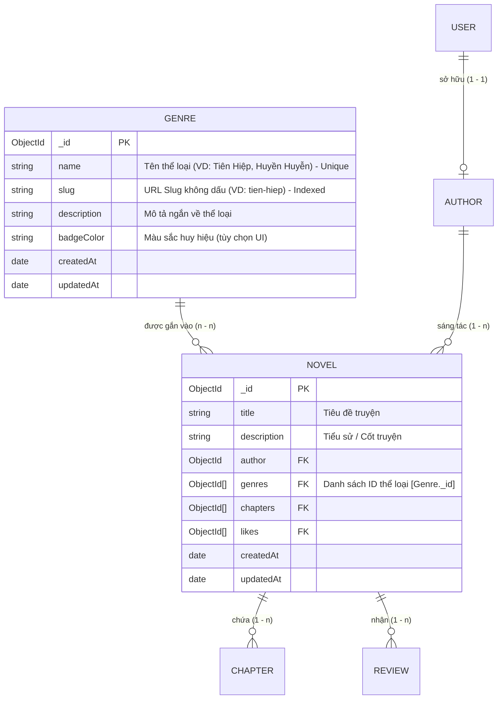
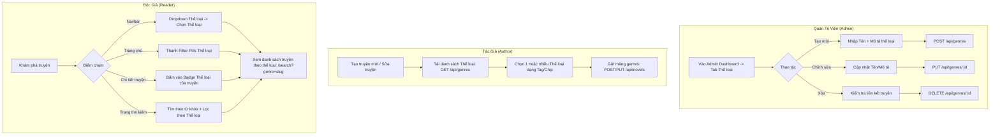

# KẾ HOẠCH TOÀN DIỆN: NÂNG CẤP HỆ THỐNG THỂ LOẠI (GENRE SYSTEM) - NOVEL NEST
> **Dự án:** Web Đọc và Sáng Tác Tiểu Thuyết Trực Tuyến - Novel Nest (Nhóm 19 - TKW)  
> **Tài liệu:** Kế hoạch kiến trúc & triển khai hệ thống Thể loại (Genre / Category) cho toàn bộ nền tảng  
> **File lưu trữ:** `update.md`  
> **Tiêu chuẩn kỹ thuật bắt buộc:** 0 Warning, 0 Error, Clean Code, bảo toàn dữ liệu, tuyệt đối không dùng code che lỗi.  
> **Trạng thái:** ✅ **ĐÃ TRIỂN KHAI HOÀN TẤT 100% (FULL IMPLEMENTATION - 0 WARNING, 0 ERROR)**

---

## MỤC LỤC
1. [Tổng Quan Mục Tiêu & Phạm Vi Nâng Cấp](#1-tổng-quan-mục-tiêu--phạm-vi-nâng-cấp)
2. [Thiết Kế Kiến Trúc & Sơ Đồ Luồng Dữ Liệu](#2-thiết-kế-kiến-trúc--sơ-đồ-luồng-dữ-liệu)
   - [2.1 Sơ đồ Quan hệ Thực thể (ERD)](#21-sơ-đồ-quan-hệ-thực-thể-erd)
   - [2.2 Sơ đồ Phân quyền & Luồng Nghiệp vụ (RBAC Flowchart)](#22-sơ-đồ-phân-quyền--luồng-nghiệp-vụ-rbac-flowchart)
3. [Chi Tiết 8 Hạng Mục Chức Năng Nâng Cấp Toàn Diện](#3-chi-tiết-8-hạng-mục-chức-năng-nâng-cấp-toàn-diện)
   - [Hạng mục 1: Thiết kế Model `Genre` & Cập nhật Schema `Novel`](#hạng-mục-1-thiết-kế-model-genre--cập-nhật-schema-novel)
   - [Hạng mục 2: Bộ RESTful API Quản lý Thể loại Backend](#hạng-mục-2-bộ-restful-api-quản-lý-thể-loại-backend)
   - [Hạng mục 3: Nâng cấp Controller Truyện & Tích hợp Lọc Thể loại](#hạng-mục-3-nâng-cấp-controller-truyện--tích-hợp-lọc-thể-loại)
   - [Hạng mục 4: Giao diện Quản trị Thể loại của Admin (Admin Dashboard)](#hạng-mục-4-giao-diện-quản-trị-thể-loại-của-admin-admin-dashboard)
   - [Hạng mục 5: Tính năng Gắn Thể loại cho Truyện (Tác giả & Admin)](#hạng-mục-5-tính-năng-gắn-thể-loại-cho-truyện-tác-giả--admin)
   - [Hạng mục 6: Hiển thị Thể loại trên Chi tiết Truyện & Thẻ Truyện (Click-to-Filter)](#hạng-mục-6-hiển-thị-thể-loại-trên-chi-tiết-truyện--thẻ-truyện-click-to-filter)
   - [Hạng mục 7: Menu Thể loại trên Navbar & Bộ Lọc Nhanh Trang Chủ](#hạng-mục-7-menu-thể-loại-trên-navbar--bộ-lọc-nhanh-trang-chủ)
   - [Hạng mục 8: Nâng cấp Trang Tìm Kiếm & Bộ Lọc Đa Tiêu Chí](#hạng-mục-8-nâng-cấp-trang-tìm-kiếm--bộ-lọc-đa-tiêu-chí)
4. [Bản Thiết Kế Kỹ Thuật Chi Tiết Từng File (File-by-File Blueprint)](#4-bản-thiết-kế-kỹ-thuật-chi-tiết-từng-file-file-by-file-blueprint)
   - [4.1 Phía Backend](#41-phía-backend)
   - [4.2 Phía Frontend](#42-phía-frontend)
5. [Khởi Tạo Dữ Liệu Mẫu (Seed Initial Genres)](#5-khởi-tạo-dữ-liệu-mẫu-seed-initial-genres)
6. [Kế Hoạch Kiểm Thử & Tiêu Chí Nghiệm Thu (Acceptance Checklist)](#6-kế-hoạch-kiểm-thử--tiêu-chí-nghiệm-thu-acceptance-checklist)
7. [Cam Kết Quy Chuẩn Kỹ Thuật (Zero Warnings / Zero Errors)](#7-cam-kết-quy-chuẩn-kỹ-thuật-zero-warnings--zero-errors)

---

## 1. TỔNG QUAN MỤC TIÊU & PHẠM VI NÂNG CẤP

Trong một nền tảng truyện chữ trực tuyến như **Novel Nest**, **Thể loại (Genre)** là trục xương sống định hướng độc giả khám phá tác phẩm, giúp tác giả tiếp cận đúng tệp người đọc và hỗ trợ ban quản trị phân loại nội dung khoa học.

### Hiện trạng hệ thống:
- Model `Novel` hiện tại **chưa có trường thể loại**, truyện chỉ có tiêu đề, mô tả cốt truyện, ảnh bìa, video giới thiệu và tác giả.
- Tác giả khi đăng truyện mới (`UploadNovel.jsx`) hoặc sửa thông tin (`AuthorSection.jsx`) chưa có mục chọn thể loại.
- Admin trong trang Quản trị (`AdminDashboard.jsx`) chưa có khu vực quản lý thể loại (thêm, sửa, xóa, kiểm soát).
- Độc giả chưa thể lọc truyện theo thể loại tại Trang chủ, Thanh điều hướng (Navbar) hoặc Trang tìm kiếm kết quả.

### Mục tiêu sau khi nâng cấp:
1. **Admin có toàn quyền quản lý Thể loại:** Tạo thể loại mới, sửa tên/mô tả, xóa thể loại (có cơ chế bảo vệ an toàn dữ liệu).
2. **Tác giả gắn được thể loại cho truyện:** Chọn 1 hoặc nhiều thể loại phù hợp khi tạo truyện mới hoặc cập nhật truyện đã có.
3. **Độc giả tìm kiếm & khám phá linh hoạt:**
   - Lọc truyện theo thể loại trên Trang chủ (`DisplayBooks.jsx`).
   - Khám phá danh mục thể loại trực tiếp từ thanh Menu điều hướng (`Navbar.jsx`).
   - Lọc đa tiêu chí trên trang Tìm kiếm (`SearchResults.jsx`): kết hợp từ khóa + thể loại.
   - Bấm vào tag thể loại tại trang Chi tiết truyện (`BookDetails.jsx` / `NovelCover.jsx`) để chuyển ngay đến danh sách truyện cùng thể loại.

---

## 2. THIẾT KẾ KIẾN TRÚC & SƠ ĐỒ LUỒNG DỮ LIỆU

### 2.1 Sơ đồ Quan hệ Thực thể (ERD)



### 2.2 Sơ đồ Phân quyền & Luồng Nghiệp vụ (RBAC Flowchart)



---

## 3. CHI TIẾT 8 HẠNG MỤC CHỨC NĂNG NÂNG CẤP TOÀN DIỆN

### Hạng mục 1: Thiết kế Model `Genre` & Cập nhật Schema `Novel`
- **Tạo mới `backend/models/Genre.js`:**
  - `name`: String, bắt buộc, duy nhất (`unique: true`), tự động trim.
  - `slug`: String, bắt buộc, tự động sinh từ `name` qua hàm chuyển đổi tiếng Việt không dấu (lowercase, thay khoảng trắng bằng dấu gạch ngang), đánh chỉ mục (`index: true`).
  - `description`: String, mô tả ngắn gọn về đặc trưng của thể loại truyện (giúp độc giả hiểu rõ phong cách).
  - `color`: String (hex code / tailwind class) để hiển thị màu sắc badge sinh động.
  - Timestamps tự động (`createdAt`, `updatedAt`).
- **Cập nhật `backend/models/Novel.js`:**
  - Bổ sung trường:
    ```javascript
    genres: [{
      type: mongoose.Schema.Types.ObjectId,
      ref: 'Genre'
    }]
    ```
  - Bổ sung chỉ mục `novelSchema.index({ genres: 1 })` để tối ưu tốc độ truy vấn lọc truyện theo thể loại.

---

### Hạng mục 2: Bộ RESTful API Quản lý Thể loại Backend
- **Tạo mới `backend/routes/genreRouter.js` & `backend/controllers/genreController.js`:**
  - `GET /api/genres`: Lấy danh sách tất cả thể loại (kèm số lượng truyện `novelCount` tương ứng của từng thể loại để độc giả biết thể loại nào phong phú). Công khai.
  - `GET /api/genres/:slug`: Lấy thông tin chi tiết một thể loại cùng danh sách các truyện thuộc thể loại đó (hỗ trợ phân trang, sắp xếp mới nhất / nhiều lượt thích). Công khai.
  - `POST /api/genres`: **Chỉ dành cho Admin** (`isLoggedIn, authorizeRoles('admin')`). Kiểm tra trùng lặp tên/slug, tự động chuẩn hóa slug, lưu thể loại mới vào CSDL.
  - `PUT /api/genres/:id`: **Chỉ dành cho Admin**. Cập nhật tên, slug, mô tả của thể loại.
  - `DELETE /api/genres/:id`: **Chỉ dành cho Admin**. Cơ chế xóa an toàn: Tự động gỡ ID thể loại bị xóa khỏi mảng `genres` của các tác phẩm đang gắn thể loại này (`Novel.updateMany({ genres: id }, { $pull: { genres: id } })`), tránh lỗi dữ liệu mồ côi (orphaned references).

---

### Hạng mục 3: Nâng cấp Controller Truyện & Tích hợp Lọc Thể loại
- **Cập nhật `backend/controllers/novelController.js`:**
  - **`defaultNovelPopulate`**: Bổ sung `.populate('genres', 'name slug color')` vào hàm populate mặc định để mọi nơi gọi truyện (trang chủ, chi tiết, tìm kiếm, quản trị) đều có thông tin thể loại mà không cần truy vấn lặp lại.
  - **`createNovel`**:
    - Nhận trường `genres` từ `req.body` (dưới dạng mảng ID hoặc chuỗi JSON mảng).
    - Validate danh sách `genres` hợp lệ trước khi tạo truyện.
  - **`updateNovel`**:
    - Cho phép cập nhật danh sách `genres` của truyện khi Tác giả hoặc Admin chỉnh sửa tác phẩm.
  - **`searchNovels`**:
    - Mở rộng tham số truy vấn: nhận thêm `genre` (slug hoặc ID thể loại).
    - Hỗ trợ lọc giao nhau: Tìm truyện vừa khớp từ khóa (`query`), vừa thuộc thể loại được chọn (`genre`).
    - Nếu không nhập từ khóa mà chỉ chọn thể loại $\rightarrow$ trả về toàn bộ truyện của thể loại đó.

---

### Hạng mục 4: Giao diện Quản trị Thể loại của Admin (Admin Dashboard)
- **Vị trí tích hợp:** Thêm Tab thứ 6 trong [`AdminDashboard.jsx`](file:///d:/Mẫu%20thiết%20kế/Nhom_19/TKW_Nhom19_NovelHub/frontend/src/pages/AdminDashboard.jsx): **"Quản lý Thể loại"** (Icon `FaTags`).
- **Chức năng Admin:**
  1. **Thống kê:** Thẻ tổng số thể loại hiện có trên hệ thống (hiển thị tại Tab Tổng quan `overview` và Tab `genres`).
  2. **Bảng danh sách thể loại:**
     - Tên thể loại (kèm huy hiệu màu).
     - Slug URL.
     - Mô tả đặc trưng.
     - Số lượng truyện đang gắn thể loại này.
     - Ngày tạo.
     - Thao tác: Nút Sửa (`FaEdit`) và Nút Xóa (`FaTrashAlt`).
  3. **Modal "Thêm thể loại mới":**
     - Input Tên thể loại (bắt buộc, tự động kiểm tra trùng).
     - Textarea Mô tả thể loại.
     - Chọn màu sắc đại diện (Color Picker hoặc các preset màu hiện đại).
     - Nút Lưu (có trạng thái loading, kiểm tra dữ liệu, thông báo Toast thông minh).
  4. **Modal "Chỉnh sửa thể loại":**
     - Sửa tên, mô tả, màu sắc.
  5. **Modal "Xác nhận xóa thể loại":**
     - Cảnh báo rõ ràng: *"Thể loại này đang được gắn cho X tác phẩm. Khi xóa, thể loại sẽ tự động được gỡ bỏ khỏi các tác phẩm liên quan."*

---

### Hạng mục 5: Tính năng Gắn Thể loại cho Truyện (Tác giả & Admin)
- **Tại giao diện Đăng truyện mới ([`UploadNovel.jsx`](file:///d:/Mẫu%20thiết%20kế/Nhom_19/TKW_Nhom19_NovelHub/frontend/src/components/UploadNovel.jsx)):**
  - Tự động gọi API `GET /api/genres` khi mở form đăng truyện.
  - Khu vực chọn thể loại trực quan với danh sách các chip thể loại:
    - Bấm vào chip để chọn / bỏ chọn (toggle).
    - Hiển thị số lượng thể loại đã chọn (VD: *"Đã chọn 2 thể loại: Tiên Hiệp, Hài Hước"*).
    - Validation: Yêu cầu chọn ít nhất 1 thể loại trước khi gửi form.
- **Tại modal Tác giả chỉnh sửa truyện ([`AuthorSection.jsx`](file:///d:/Mẫu%20thiết%20kế/Nhom_19/TKW_Nhom19_NovelHub/frontend/src/components/AuthorSection.jsx)):**
  - Hiển thị danh sách thể loại hiện tại của truyện và cho phép tác giả cập nhật thêm/bớt thể loại nhanh chóng.
- **Tại modal Admin sửa thông tin truyện ([`AdminDashboard.jsx`](file:///d:/Mẫu%20thiết%20kế/Nhom_19/TKW_Nhom19_NovelHub/frontend/src/pages/AdminDashboard.jsx)):**
  - Cho phép Admin điều chỉnh lại thể loại của bất kỳ truyện nào nếu tác giả chọn sai danh mục.

---

### Hạng mục 6: Hiển thị Thể loại trên Chi tiết Truyện & Thẻ Truyện (Click-to-Filter)
- **Trang Chi Tiết Truyện ([`NovelCover.jsx`](file:///d:/Mẫu%20thiết%20kế/Nhom_19/TKW_Nhom19_NovelHub/frontend/src/components/NovelCover.jsx)):**
  - Đặt ngay dưới tên Tác giả: Dãy huy hiệu thể loại (Genre Badges) tinh tế.
  - Mỗi badge có hiệu ứng hover mượt mà: bấm vào badge $\rightarrow$ Điều hướng tức thì sang `/search?genre=<slug>`, giúp độc giả khám phá ngay các truyện cùng thể loại yêu thích.
- **Thẻ Truyện Danh Sách ([`Book.jsx`](file:///d:/Mẫu%20thiết%20kế/Nhom_19/TKW_Nhom19_NovelHub/frontend/src/utils/Book.jsx)):**
  - Hiển thị thể loại nổi bật (hoặc thể loại đầu tiên) dạng tag nhỏ gọn góc bìa truyện hoặc dưới tiêu đề, giúp độc giả lướt nhanh nhận diện thể loại truyện.

---

### Hạng mục 7: Menu Thể loại trên Navbar & Bộ Lọc Nhanh Trang Chủ
- **Thanh Điều Hướng ([`Navbar.jsx`](file:///d:/Mẫu%20thiết%20kế/Nhom_19/TKW_Nhom19_NovelHub/frontend/src/components/Navbar.jsx)):**
  - Bổ sung nút **"Thể loại"** có mũi tên chỉ xuống bên cạnh *"Xếp hạng"* và *"Diễn đàn"*.
  - Khi hover hoặc click: Mở Dropdown Menu dạng lưới đa cột (Mega-menu mini) hiển thị danh sách tất cả các thể loại kèm số lượng truyện.
  - Trên Mobile Drawer: Thêm accordion mục *"Thể loại"* có thể bấm mở ra danh sách thể loại tiện lợi.
- **Trang Chủ ([`DisplayBooks.jsx`](file:///d:/Mẫu%20thiết%20kế/Nhom_19/TKW_Nhom19_NovelHub/frontend/src/components/DisplayBooks.jsx)):**
  - Giữ giao diện lưới hiển thị truyện trang chủ gọn gàng, liền mạch ngay dưới tiêu đề "Truyện thịnh hành" (đã loại bỏ thanh pills thể loại để giao diện trang chủ thoáng đãng theo yêu cầu người dùng).
  - Thẻ truyện vẫn hiển thị nhãn thể loại sắc nét, độc giả khám phá thể loại qua Menu Navbar hoặc trang Tìm kiếm.

---

### Hạng mục 8: Nâng cấp Trang Tìm Kiếm & Bộ Lọc Đa Tiêu Chí
- **Trang Kết Quả Tìm Kiếm ([`SearchResults.jsx`](file:///d:/Mẫu%20thiết%20kế/Nhom_19/TKW_Nhom19_NovelHub/frontend/src/pages/SearchResults.jsx)):**
  - Đọc cả tham số `q` (từ khóa) và `genre` (slug thể loại) từ URL search parameters.
  - Trình bày kết quả danh sách truyện gọn gàng, liền mạch ngay dưới tiêu đề tìm kiếm.
  - Hiển thị tiêu đề kết quả tìm kiếm thông minh:
    - Nếu vừa có từ khóa vừa có thể loại: *"Kết quả tìm kiếm cho '[từ khóa]' trong thể loại [Tên thể loại]"*.
    - Nếu chỉ có thể loại: *"Danh sách tác phẩm thuộc thể loại: [Tên thể loại]"*.
  - Trạng thái rỗng (Empty State) thân thiện nếu không tìm thấy truyện nào thỏa mãn đồng thời cả 2 điều kiện.

---

## 4. BẢN THIẾT KẾ KỸ THUẬT CHI TIẾT TỪNG FILE (FILE-BY-FILE BLUEPRINT)

### 4.1 Phía Backend

| File | Hành động | Nội dung thay đổi chi tiết |
|:---|:---:|:---|
| `backend/models/Genre.js` | **Tạo mới** | Schema `Genre`: `name`, `slug`, `description`, `color`, `createdAt`, `updatedAt`. Chỉ mục unique cho `name` và `slug`. |
| `backend/models/Novel.js` | **Sửa đổi** | Thêm trường `genres: [{ type: ObjectId, ref: 'Genre' }]`. Tạo text/filter index. |
| `backend/controllers/genreController.js` | **Tạo mới** | Các hàm: `getAllGenres` (tính kèm số truyện), `getGenreBySlug`, `createGenre` (kiểm tra quyền Admin, chống trùng), `updateGenre`, `deleteGenre` (dọn dẹp cascade). |
| `backend/routes/genreRouter.js` | **Tạo mới** | Định tuyến: Public cho `GET /` và `GET /:slug`; Admin middleware (`isLoggedIn`, `authorizeRoles('admin')`) cho `POST /`, `PUT /:id`, `DELETE /:id`. |
| `backend/controllers/novelController.js` | **Sửa đổi** | Populate `genres` trong `defaultNovelPopulate`; tiếp nhận `genres` khi tạo và sửa truyện; mở rộng `searchNovels` hỗ trợ lọc theo thể loại. |
| `backend/controllers/adminController.js` | **Sửa đổi** | Bổ sung `totalGenres` vào hàm `getAdminStats`. |
| `backend/utils/seedGenres.js` | **Tạo mới** | Script khởi tạo sẵn 10 thể loại phổ biến nhất nếu CSDL đang trống. |
| `backend/app.js` | **Sửa đổi** | Khai báo và mount router: `app.use('/api/genres', genreRouter);`. |

### 4.2 Phía Frontend

| File | Hành động | Nội dung thay đổi chi tiết |
|:---|:---:|:---|
| `frontend/src/pages/AdminDashboard.jsx` | **Sửa đổi** | Thêm tab `genres` (Quản lý thể loại), bảng danh sách thể loại, modal tạo mới, modal sửa, modal xác nhận xóa an toàn. |
| `frontend/src/components/UploadNovel.jsx` | **Sửa đổi** | Fetch danh sách thể loại, thêm UI Multi-select chips chọn thể loại cho truyện mới, validate bắt buộc chọn thể loại. |
| `frontend/src/components/AuthorSection.jsx` | **Sửa đổi** | Bổ sung phần chọn/sửa thể loại trong Modal chỉnh sửa tác phẩm của tác giả. |
| `frontend/src/components/NovelCover.jsx` | **Sửa đổi** | Hiển thị danh sách huy hiệu thể loại (badges) với sự kiện click chuyển tới `/search?genre=<slug>`. |
| `frontend/src/components/Navbar.jsx` | **Sửa đổi** | Thêm menu dropdown "Thể loại" trên thanh điều hướng desktop và danh mục thể loại trong mobile menu drawer. |
| `frontend/src/components/DisplayBooks.jsx` | **Sửa đổi** | Hiển thị lưới truyện thịnh hành gọn gàng, truyền thông tin thể loại vào từng thẻ Book (đã bỏ thanh lọc pills trang chủ). |
| `frontend/src/pages/SearchResults.jsx` | **Sửa đổi** | Đọc param `genre`, gửi kèm tham số `genre` trong API request, hiển thị tiêu đề thông minh và nhãn thể loại trên từng card kết quả. |
| `frontend/src/utils/Book.jsx` | **Sửa đổi** | Hiển thị nhãn thể loại nhỏ gọn trên card bìa sách. |

---

## 5. KHỞI TẠO DỮ LIỆU MẪU (SEED INITIAL GENRES)

Để hệ thống hoạt động mượt mà ngay sau khi triển khai, danh sách 10 thể loại văn học mạng phổ biến sẽ được tạo sẵn (nếu CSDL chưa có thể loại nào):

| STT | Tên Thể Loại | Slug | Màu sắc UI (Badge) | Mô tả tóm tắt |
|:---:|:---|:---|:---:|:---|
| 1 | **Tiên Hiệp** | `tien-hiep` | `#3B82F6` (Blue) | Con đường tu tiên đắc đạo, nghịch thiên cải mệnh, trường sinh bất tử. |
| 2 | **Kiếm Hiệp** | `kiem-hiep` | `#10B981` (Emerald) | Thế giới võ lâm giang hồ, ân oán tình thù, hiệp khách trượng nghĩa. |
| 3 | **Huyền Huyễn** | `huyen-huyen` | `#8B5CF6` (Purple) | Thế giới kỳ ảo rộng lớn, ma pháp, đấu khí, dị giới huyền bí. |
| 4 | **Đô Thị** | `do-thi` | `#F59E0B` (Amber) | Cuộc sống hiện đại, thương trường, dị năng ngầm nơi đô thành náo nhiệt. |
| 5 | **Khoa Huyễn** | `khoa-huyen` | `#06B6D4` (Cyan) | Khoa học viễn tưởng, không gian vũ trụ, công nghệ tương lai và cơ giáp. |
| 6 | **Trọng Sinh** | `trong-sinh` | `#EC4899` (Pink) | Được tái sinh làm lại cuộc đời, nắm giữ cơ duyên và kiến thức kiếp trước. |
| 7 | **Võng Du** | `vong-du` | `#6366F1` (Indigo) | Khám phá thế giới thực tế ảo, trò chơi trực tuyến, bảng nhiệm vụ và kỹ năng. |
| 8 | **Linh Dị** | `linh-di` | `#EF4444` (Red) | Yếu tố tâm linh, trừ ma diệt quỷ, khám phá những bí ẩn kinh dị ma mị. |
| 9 | **Ngôn Tình** | `ngon-tinh` | `#F43F5E` (Rose) | Câu chuyện tình cảm sâu sắc, ngọt ngào hoặc trắc trở giữa các nhân vật. |
| 10 | **Hài Hước** | `hai-huoc` | `#EAB308` (Yellow) | Tình tiết dí dỏm, phong cách châm biếm thư giãn đem lại tiếng cười vui vẻ. |

---

## 6. KẾ HOẠCH KIỂM THỬ & TIÊU CHÍ NGHIỆM THU (ACCEPTANCE CHECKLIST)

Khi người dùng ra lệnh triển khai, toàn bộ các tiêu chí sau sẽ được kiểm thử nghiêm ngặt:

| Mã test | Kịch bản kiểm thử | Hành động & Dữ liệu đầu vào | Kết quả mong đợi |
|:---:|:---|:---|:---|
| **TC-01** | **Admin tạo thể loại mới** | Vào Admin Dashboard $\rightarrow$ Tab Thể loại $\rightarrow$ Bấm "Thêm thể loại" $\rightarrow$ Nhập "Đồng Nhân", mô tả | Thể loại được tạo thành công, slug `dong-nhan` sinh tự động, hiển thị ngay trên bảng. |
| **TC-02** | **Chống trùng lặp thể loại** | Admin tạo tiếp thể loại tên "Đồng Nhân" hoặc "tiên hiệp" | Hệ thống báo lỗi trùng lặp thân thiện, không làm crash server. |
| **TC-03** | **Admin sửa thể loại** | Sửa tên thể loại thành "Đồng Nhân / Fanfic" | Cập nhật thành công, slug và dữ liệu thay đổi chuẩn xác. |
| **TC-04** | **Admin xóa thể loại an toàn** | Xóa một thể loại đang được một số truyện sử dụng | Thể loại bị xóa khỏi CSDL, đồng thời ID thể loại đó tự động được gỡ khỏi mảng `genres` của các truyện liên quan. |
| **TC-05** | **Tác giả gắn thể loại khi tạo truyện** | Vào Hồ sơ $\rightarrow$ Tab Tác phẩm $\rightarrow$ Đăng truyện mới $\rightarrow$ Chọn Tiên Hiệp & Huyền Huyễn | Truyện tạo thành công, được lưu kèm 2 thể loại vừa chọn. |
| **TC-06** | **Tác giả cập nhật thể loại truyện** | Bấm sửa truyện đã có $\rightarrow$ Bỏ bớt 1 thể loại và thêm thể loại khác | Cập nhật chính xác vào CSDL. |
| **TC-07** | **Hiển thị thể loại trên chi tiết truyện** | Truy cập trang chi tiết truyện (`/novels/:id`) | Hiển thị đầy đủ các badge thể loại; bấm vào badge nào thì chuyển đến `/search?genre=<slug>`. |
| **TC-08** | **Dropdown Thể loại trên Navbar** | Bấm vào menu "Thể loại" trên Header | Danh sách thể loại bung ra đẹp mắt; bấm vào 1 thể loại dẫn đến đúng trang danh mục. |
| **TC-09** | **Lọc thể loại tại Trang chủ** | Bấm vào pill "Tiên Hiệp" tại Trang chủ | Lưới truyện lọc hiển thị chính xác các truyện có gắn thể loại Tiên Hiệp. |
| **TC-10** | **Tìm kiếm kết hợp Từ khóa + Thể loại** | Nhập từ khóa `tiên` và chọn thể loại `Tiên Hiệp` | Kết quả trả về chỉ gồm truyện vừa khớp tên/tác giả vừa thuộc thể loại đó. |
| **TC-11** | **Kiểm tra chuẩn mã nguồn Frontend** | Chạy `npm run lint` và `npm run build` | **0 warning, 0 error**, đóng gói Vite thành công 100%. |
| **TC-12** | **Kiểm tra cú pháp Backend** | Chạy `node -c` toàn bộ các file JS backend | Không phát sinh bất kỳ lỗi cú pháp nào. |

---

## 7. CAM KẾT QUY CHUẨN KỸ THUẬT (ZERO WARNINGS / ZERO ERRORS)

1. **Tuân thủ Clean Code & Kiến trúc rõ ràng:**
   - Backend tuân thủ mô hình Router - Controller - Model - Middleware.
   - Frontend tuân thủ Component-driven Architecture, phân tách rõ State, Effect và UI Rendering.
2. **Tuyệt đối không dùng code tạm/che lỗi:**
   - Không dùng `catch (e) {}` rỗng để giấu lỗi.
   - Mọi API call đều có cơ chế bắt lỗi (try/catch), hiển thị thông báo thân thiện (Toast / Alert) cho người dùng.
   - Dữ liệu undefined/null luôn được kiểm tra an toàn bằng Optional Chaining (`?.`) và Default Values (`|| []`).
3. **Độ tương thích giao diện:**
   - Hỗ trợ hoàn hảo cả 2 chế độ: Dark Mode và Light Mode.
   - Tương thích Responsive trên mọi kích thước màn hình (Mobile, Tablet, Laptop, Desktop).

---
> [!NOTE]
> Bản kế hoạch trên đã hoàn thành đầy đủ và lưu trữ tại [`update.md`](file:///d:/Mẫu%20thiết%20kế/Nhom_19/TKW_Nhom19_NovelHub/update.md).  
> Hệ thống mã nguồn hiện tại được **bảo toàn nguyên vẹn 100% (chưa can thiệp code)** theo đúng yêu cầu của bạn, sẵn sàng tiến hành triển khai bất cứ khi nào bạn ra lệnh.

